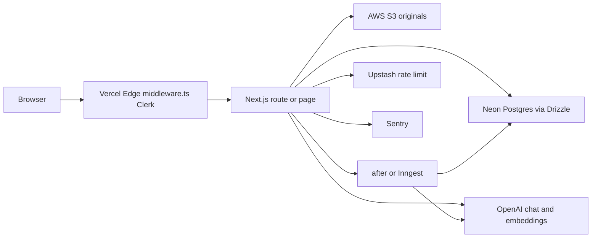

# SOL architecture briefing (from the codebase)

Written for an AI planning product, pilots, and sales. Every claim below is from this repository. Where a behavior is not implemented, the status is **NOT BUILT**. This file does not contain secrets, environment values, or student data.

Source of truth: `app/db/schema.ts` and the `lib/` and `app/api/` handlers. Design notes in `docs/architecture/scale-and-tenancy.md` and policy text in `compliance/` describe intent; where they disagree with code, this briefing follows the code. Whether production Neon has applied migrations `0021`–`0029` is **unknown from the repo**. `PRODUCTION_DEPLOY.md` still says not to migrate workspace/job changes to production until approved.

---

## 1. SYSTEM OVERVIEW

### Stack and where it runs

| Layer | What the code uses | Where it runs | Who owns the account |
| --- | --- | --- | --- |
| App | Next.js 15 App Router, React 19, Tailwind 4 (`package.json`) | Vercel serverless (Node) plus Edge middleware (`middleware.ts`) | Two Vercel projects are documented: StratOps (`www.strat-ops.net`, base path `/learning`) and teachwithsol (`app.teachwithsol.com` and sibling hosts, empty base path). `PRODUCTION_DEPLOY.md` §0. |
| Database | Neon Postgres via Drizzle, `@neondatabase/serverless` Pool (`app/db/index.ts`) | Neon (hosted Postgres). Runtime role documented as `sol_app`; migrator as `sol_migrator` (`PRODUCTION_DEPLOY.md` §4). Region is not in application code. | Neon project owner is not named in source. |
| Cache / rate limit | Upstash Redis (`@upstash/ratelimit`, `lib/rateLimit.ts`). In-memory fallback if Upstash errors at runtime, or in dev when unset. | Upstash | Account owner not in source. Required at boot in production (`lib/env.ts`). |
| Auth | Clerk (`@clerk/nextjs`). Session cookie at the edge; profile sync into `users` in `lib/getOrCreateUser.ts`. | Clerk | `PRODUCTION_DEPLOY.md` §0: production keys are locked to `strat-ops.net`; teachwithsol is a Clerk satellite on the StratOps Clerk account. |
| AI | OpenAI only (`openai` SDK). Models in code: grading `gpt-5-mini-2025-08-07` (`lib/gradingTypes.ts` `GRADING_MODEL_VERSION`); tutor default `gpt-4.1-mini` (`lib/chatbot/constants.ts` `CHATBOT_MODEL`); authoring `OPENAI_AUTHORING_MODEL` or `gpt-4o-mini` (`lib/authoring/constants.ts` `AUTHORING_MODEL`); embeddings `text-embedding-3-small` (`lib/knowledge/constants.ts` `EMBEDDING_MODEL`). | OpenAI API | Account owner not in source. `OPENAI_API_KEY` required in production (`lib/env.ts`). |
| File storage | S3 (`lib/knowledge/storage.ts`, `lib/interactives/storage.ts`). Textract OCR (`lib/knowledge/ocr.ts`). | AWS, region from `AWS_REGION` | AWS account id is not in the repo. Uploads require `AWS_S3_BUCKET` and `AWS_REGION`. Credentials use the AWS default chain (`lib/knowledge/storage.ts` `getClient`). |
| Observability | Sentry (`sentry.server.config.ts`, `sentry.edge.config.ts`, `instrumentation-client.ts`). Optional Braintrust traces (`lib/ai/tracing.ts`) when `BRAINTRUST_API_KEY` is set. | Sentry; Braintrust | Account owners not in source. |
| Background jobs | `JOBS_BACKEND=after` (default, Next `after()`) or `inngest` (`lib/env.ts`, `lib/jobs/enqueue.ts`, `lib/jobs/functions.ts`, `app/api/inngest/route.ts`). Vercel crons in `vercel.json`: grade-pending, process-materials, lti-roster, lti-passback (daily). | Inngest Cloud when configured; otherwise in-request `after()`. Crons documented to run on the StratOps Vercel project only, so two deploys do not double-process one database (`PRODUCTION_DEPLOY.md` §0). | Inngest account owner not in source. |
| Payments | Stripe Checkout + webhooks (`stripe` package). Paywall default off via `NEXT_PUBLIC_PAYMENTS_ENABLED` (`lib/env.ts`, `lib/featureFlags.ts`). Workspace subscription checkout exists (`app/api/stripe/workspace-checkout/route.ts`). | Stripe | Account owner not in source. |
| Email / SSO IdP | No application mailer for rosters or grades was found. Institution SAML/OIDC SSO is **NOT BUILT** in `app/` or `lib/` (no SAML, no Clerk Organizations). Campus login that exists is Canvas LTI, not campus SSO. | — | — |

### Request flow

A browser request hits Clerk middleware on the Edge (`middleware.ts`). That layer checks the Clerk session and host routing. It does not query Postgres. The Node handler then calls `getOrCreateUser` (`lib/getOrCreateUser.ts`), which upserts a `users` row from the Clerk profile and never overwrites `role` or `paid` on later syncs. The handler authorizes with `lib/auth.ts` (global role) and, for teaching data, with section enrollment or workspace membership helpers. Reads and writes go to Neon through Drizzle (`app/db/index.ts`). AI calls leave the process only from the OpenAI client in grading, rubric derivation, authoring, embeddings, and the tutor. File bytes go to S3; extracted text, chunks, and vectors stay in Neon. Short-answer grading on submit is queued (`attempts.grading_status = partial`) and finished by `after()` or Inngest (`lib/jobs/enqueue.ts` `enqueueGradeAttempt`). The JSON or HTML response returns to the browser.



---

## 2. DATA MODEL

All tables are in `app/db/schema.ts`. There is no Postgres row-level security on current tables. `drizzle/0002_cheerful_red_wolf.sql` disables RLS on legacy tables `course_enrollments` and `quiz_courses`, which are not in the current schema.

There is no `grades` table. Scores live on `attempts`. There is no `rubrics` table. Rubrics are JSON on `questions.rubric`. There is no `discussions` table. Discussions are `chatbots` plus `chatbot_sessions`. There is no `organizations` table separate from `workspaces`. Book reading position is browser localStorage (`lib/books/readingProgress.ts`), not a table.

**PII / student text** column: `PII` = name, email, or LMS user id. `TEXT` = student-written answer or chat. `BOTH` = both. `NO` = operational or faculty content.

| Table | Purpose | Key columns and foreign keys | Student data |
| --- | --- | --- | --- |
| `users` | One SOL profile per Clerk user. Global, not per tenant. | `clerk_id` unique, `email`, `first_name`, `last_name`, `role` STUDENT/PROFESSOR/ADMIN, `paid`, `stripe_customer_id` | PII |
| `workspaces` | Tenant: creator, business, department, or institution. | `slug` unique, `type`, `status`, `parent_workspace_id` → `workspaces.id`, `settings` jsonb | NO |
| `workspace_memberships` | User membership in a workspace. Unique (`workspace_id`, `user_id`). | `role` owner/admin/instructor/learner, `status` active/invited/removed. FK user, workspace | PII via user FK |
| `workspace_licenses` | Seat and AI caps, Stripe or manual billing. | `plan`, `seat_cap`, `ai_unit_cap`, period, `billing_provider`, Stripe ids, `status`. FK workspace | NO |
| `workspace_usage_daily` | Daily AI unit rollup. Unique (`workspace_id`, `day`). | `grade_units`, `tutor_units`, `embed_units` | NO |
| `workspace_invites` | One-time claim links. Token stored as SHA-256 only. | `email`, `role` owner/admin/instructor, `token_hash`, `expires_at`, `claimed_by_user_id` | PII (invite email) |
| `courses` | Course shell inside one workspace. | `workspace_id` required, `title`, `status`, `deleted_at` | NO |
| `sections` | Section of a course. Enrollment codes are **globally unique**. | `course_id`, `professor_enrollment_code`, `student_enrollment_code`, `ends_at`, `deleted_at` | NO (codes are secrets) |
| `professor_sections` | Faculty teaching assignment. Unique (professor, section). | `professor_id` → `users`, `section_id`, `status` ACTIVE/INACTIVE | PII via user FK |
| `student_sections` | Learner enrollment. Unique (student, section). | `student_id` → `users`, `section_id`, `status` ACTIVE/DROPPED | PII via user FK |
| `quizzes` | Quiz owned by a professor, not by a course or workspace. | `professor_id` → `users` (restrict), `max_attempts`, `time_limit`, `passing_score`, dates, `source_outline_item_id`, `deleted_at` | NO |
| `quiz_sections` | Quiz assigned to a section. Unique (quiz, section). | `quiz_id`, `section_id`, `assigned_by` → `users` | NO |
| `questions` | Quiz items. | `quiz_id`, `type` MULTIPLE_CHOICE/TRUE_FALSE/SHORT_ANSWER, `question`, `options`, `correct_answer`, `points`, `rubric` jsonb, `rubric_version`, `concept_tags` | NO (reference answers are faculty content) |
| `assignments` | One row per (quiz, student). | `quiz_id`, `student_id`, `due_date`, `is_completed` | PII via student FK |
| `attempts` | A submission. | `assignment_id`, `student_id`, `quiz_id`, `section_id`, `answers` jsonb, `score`, `max_score`, `percentage`, `passed`, `gpt_feedback` jsonb, `grading_status` complete/partial/failed | BOTH (`answers`, feedback evidence) |
| `grading_cache` | Cache of short-answer grades. PK is a hash key. | `question_id`, `rubric_version`, `model_version`, `payload` jsonb | TEXT (quotes inside payload) |
| `stripe_events` | Webhook idempotency. | `event_id` unique, `type`, `payload` jsonb | PII possible inside Stripe payload |
| `clerk_events` | Webhook idempotency. | `event_id` unique, `type`, `payload` jsonb | PII possible inside Clerk payload |
| `audit_log` | Append-only. Trigger in `drizzle/0011_audit_log_append_only.sql` rejects UPDATE/DELETE. | `actor_user_id`, `actor_clerk_id`, `action`, `target_type`, `target_id`, `metadata`, `ip`, `user_agent` | PII (actor ids, IP, UA; user-delete metadata stores email) |
| `professor_api_tokens` | MCP personal access tokens. Hash only. | `user_id`, `token_hash`, `prefix`, `scopes`, `expires_at`, `revoked_at` | NO (owner FK) |
| `chatbots` | Socratic discussion bots. | `professor_id` nullable for templates, `title`, `instructions`, `system_prompt`, `related_quiz_id`, `is_template`, `model`, `deleted_at` | NO |
| `chatbot_sections` | Discussion assigned to a section. | `chatbot_id`, `section_id`, `assigned_by` | NO |
| `chatbot_assignments` | One row per (chatbot, student). | `chatbot_id`, `student_id`, `is_completed` | PII via student FK |
| `course_materials` | Legacy course-scoped library (uploads, URLs, book index). | `course_id`, `uploaded_by_user_id`, `source_type` UPLOAD/URL, `s3_key`, `external_url`, `status`, `authoring_corpus` prior_course/this_term, `deleted_at` | NO (faculty files; may contain third-party text) |
| `course_material_chunks` | Chunks + `vector(1536)` for legacy materials. | `material_id`, `course_id`, `content`, `embedding`, `deleted_at` | NO |
| `knowledge_connectors` | Workspace OAuth connectors. | `workspace_id`, `provider` google_drive/onedrive/sharepoint/notion/confluence, `encrypted_tokens`, `config`, `status` | NO (tokens are secrets) |
| `knowledge_documents` | Shared library document, workspace-owned. | `workspace_id`, `source_kind` UPLOAD/URL/CONNECTOR, `visibility` personal/workspace, `current_version_id`, `legacy_material_id`, `created_by_user_id` | NO |
| `knowledge_document_versions` | File versions. | `document_id`, `version`, `s3_key`, `checksum`, `ocr_used` | NO |
| `knowledge_chunks` | Chunks + embeddings for the shared library. | `document_id`, `version_id`, `workspace_id`, `content`, `embedding`, `superseded_at` | NO |
| `course_knowledge_links` | Pins a workspace document (and version) onto a course for RAG. | `course_id`, `document_id`, `pinned_version_id`, `update_available_version_id`, `authoring_corpus` | NO |
| `knowledge_sync_runs` | Connector sync log. | `connector_id`, `workspace_id`, counts, `status`, `meta` | NO |
| `hosted_books` | Pressbooks URL, EPUB, or Pressbooks XML. | `course_id`, `created_by_user_id`, `source_kind`, `s3_key`, `is_released`, `status` | NO |
| `book_chapters` | Chapter body. | `book_id`, `course_id`, `parent_id` self-FK, `markdown`, `html`, `material_id` | NO |
| `book_sections` | Book released to a section. | `book_id`, `section_id`, `assigned_by` | NO |
| `lessons` | Released lesson markdown. | `professor_id`, `course_id`, `markdown`, `is_active`, `source_outline_item_id` | NO |
| `lesson_sections` | Lesson assigned to a section. | `lesson_id`, `section_id`, `assigned_by` | NO |
| `flashcards` | Cards on a lesson. | `lesson_id`, `front`, `back` | NO |
| `lesson_progress` | Per student per lesson. Unique (lesson, student). | `status` STARTED/COMPLETED | PII via student FK |
| `interactives` | Activity body or H5P package. | `professor_id`, `course_id`, `kind`, `body` jsonb, `package_storage_key`, `is_active` | NO |
| `interactive_sections` | Interactive assigned to a section. | `interactive_id`, `section_id` | NO |
| `interactive_progress` | Per student. | `status`, `xapi_summary` jsonb | PII; xAPI may include student activity text |
| `course_activities` | Registry so quizzes, lessons, discussions, and interactives share one list. Polymorphic: one of the entity FKs. | `course_id`, `professor_id`, `type` QUIZ/LESSON/DISCUSSION/INTERACTIVE, dates | NO |
| `course_outlines` | Authoring outline. | `course_id`, `created_by_user_id`, `status`, `brief`, `has_prior_corpus`, `bodies_built` | NO |
| `outline_modules` | Modules in an outline. | `outline_id`, `title`, `summary`, `position` | NO |
| `outline_items` | Draft lesson/quiz/discussion/interactive. | `module_id`, `type`, `body` jsonb, `variant_of_item_id`, `faithful_body`, published entity FKs | NO |
| `authoring_revisions` | JSON snapshot of an outline. | `outline_id`, `label`, `snapshot` | NO |
| `authoring_policies` | One standards row per workspace. Unique `workspace_id`. | `structure_notes`, `rubric_style`, `tone`, `extra_prompt` | NO |
| `authoring_messages` | Faculty chat with the authoring model. | `outline_id`, `role`, `content` | NO (faculty text) |
| `chatbot_sessions` | Tutor transcript. | `assignment_id` → `chatbot_assignments`, `student_id`, `chatbot_id`, `section_id`, `messages` jsonb, `status` | BOTH |
| `lti_platforms` | Canvas LTI 1.3 platform per workspace. Unique (workspace, issuer, client id). | issuer, client id, auth URLs, JWKS URL | NO |
| `lti_deployments` | Deployment id on a platform. | `platform_id`, `deployment_id`, `status` | NO |
| `lti_section_links` | SOL section ↔ Canvas course. One link per section. | `section_id`, `deployment_id`, `canvas_course_id`, `ags_line_items_url`, `nrps_memberships_url` | NO |
| `lti_user_links` | SOL user ↔ LTI `sub`. Unique (platform, lti user). | `user_id`, `lti_user_id`, `email_snapshot` | PII |
| `lti_line_items` | AGS line item for an activity in a linked section. | `section_link_id`, activity FKs, `line_item_url`, `score_maximum` | NO |
| `lti_passback_jobs` | Grade passback queue. Unique `idempotency_key`. | `line_item_id`, `user_id`, `attempt_id`, `score_given`, `status` pending/sent/failed | PII via user FK; score |

### How the main objects relate

```text
workspaces 1—* workspace_memberships *—1 users
workspaces 1—* courses 1—* sections
sections 1—* professor_sections *—1 users
sections 1—* student_sections *—1 users
users(professor) 1—* quizzes 1—* questions
quizzes *—* sections via quiz_sections
quizzes 1—* assignments *—1 users(student) 1—* attempts
chatbots *—* sections via chatbot_sections
chatbots 1—* chatbot_assignments 1—* chatbot_sessions
courses 1—* course_materials 1—* course_material_chunks
workspaces 1—* knowledge_documents 1—* knowledge_chunks
courses *—* knowledge_documents via course_knowledge_links
courses 1—* course_outlines 1—* outline_modules 1—* outline_items
workspaces 1—* lti_platforms 1—* lti_deployments 1—* lti_section_links *—1 sections
```

A quiz is not a child of a course. It reaches a course only by being assigned to a section of that course (`quiz_sections`). The same is true of discussions (`chatbots`). Lessons and interactives do have `course_id`.

---

## 3. TENANCY AND ISOLATION

### What exists today

A tenant is a **workspace** (`workspaces`), not a separate institution table. Types in the schema: `creator`, `business`, `department`, `institution`. Status: `trial`, `active`, `suspended`, `churned`. `parent_workspace_id` can point at another workspace. The only code that reads the parent link for behavior is admin delete, which refuses to delete a workspace that still has children (`app/api/admin/workspaces/[workspaceId]/route.ts`). Access checks do not walk ancestors or descendants.

Users belong through `workspace_memberships` (`lib/workspace/access.ts` `ensureWorkspaceMembership`). Roles on the membership: `owner`, `admin`, `instructor`, `learner`. This is separate from the global `users.role` (`STUDENT`, `PROFESSOR`, `ADMIN`).

A stable default workspace id is hardcoded: `DEFAULT_WORKSPACE_ID` in `app/db/schema.ts`. `ensureDefaultWorkspace` (`lib/workspace/access.ts`) inserts slug `default`, type `institution`, and a manual institution license with seat cap 100000 if missing.

**How data is scoped**

| Mechanism | Present? |
| --- | --- |
| `workspace_id` on every table | No. Present on `courses`, licenses, memberships, usage, invites, knowledge documents/chunks/connectors, authoring policies, LTI platforms. Absent on quizzes, questions, attempts, chatbots, lessons, sections (they inherit only by joining `courses`). |
| Row-level security | **NOT BUILT** on current tables. |
| Separate schema per tenant | **NOT BUILT**. One database. |
| Application checks | Yes, and they are the only isolation. |

Two scopes run at once:

1. **Workspace scope** for creating courses, seat caps, the shared knowledge library, authoring policy, and billing.
2. **Professor-section scope** for the teaching loop: gradebook, quiz attempts, tutor assignment, analytics. A professor who is enrolled in a section can manage that course’s materials even without a workspace membership (`assertCanManageCourse` in `lib/knowledge/access.ts` returns on the first `professor_sections` match).

### Where checks happen

| Check | File | What it enforces |
| --- | --- | --- |
| `requireRole` / `requireProfessor` / `requireStudent` / `requireAdmin` | `lib/auth.ts` | Global `users.role`. ADMIN passes every role check. Mismatch redirects to that user’s dashboard. |
| `userCanAccessWorkspace` | `lib/workspace/access.ts` | ADMIN always. Else active membership, else an active student enrollment in a course in that workspace. |
| `userCanCreateCoursesInWorkspace` | `lib/workspace/entitlement.ts` | Active membership role owner, admin, or instructor. |
| `assertWorkspaceAllowsCourseCreate` | `lib/workspace/entitlement.ts` | License active. Creator/business Stripe plans need a subscription id or an open complimentary window. |
| `assertSeatAvailable` | `lib/workspace/access.ts` | Called from student enroll only (`app/api/student/enroll/route.ts`). |
| `assertCanManageCourse` | `lib/knowledge/access.ts` | ADMIN, or professor enrolled in any section of the course, or workspace owner/admin of that course’s workspace. Instructors who only have a membership and do not teach the course are refused. |
| `assertTeachesSection` | `lib/professor/sections.ts` | ADMIN, or a `professor_sections` row. Used by the gradebook (`lib/professor/grading.ts` `getSectionGradebook`). |
| `professorCanAccessQuiz` | `lib/quizAccess.ts` | ADMIN, quiz owner, or professor enrolled in a section the quiz is assigned to. |
| `assertAiBandAvailable` | `lib/workspace/usage.ts` | Defined. **No caller** outside the module re-export. Caps are not enforced on grade or tutor. |

Course create (`app/api/professor/course/create/route.ts`): professors must pass a `workspaceId` they can create in, or the handler picks `listActiveMembershipsForUser(...)[0]`. Admins must pass `workspaceId`. Students are forbidden.

### Queries and endpoints that do not enforce workspace scoping

Isolation is per handler. These paths authorize by something other than `courses.workspace_id`, or by nothing tenant-shaped:

- **Platform ADMIN** bypasses workspace and section filters in `userCanAccessWorkspace`, `assertCanManageCourse`, `listTeachableCourses`, and `assertTeachesSection`. Admin pages list every workspace, course, and user (`app/dashboard/admin/page.tsx`).
- **Professor enroll by code** (`enrollInSection` in `lib/professor/mutations.ts`, route `app/api/professor/enroll/route.ts`) looks up `sections.professor_enrollment_code` globally. It does not check workspace membership and does not insert `workspace_memberships`.
- **Student enroll by code** (`app/api/student/enroll/route.ts`) looks up `sections.student_enrollment_code` globally, then applies that course’s seat cap and inserts a learner membership. Any student with the code can join any workspace’s section.
- **Quiz library** is `quizzes.professor_id`, not a workspace. `createQuiz` (`lib/professor/mutations.ts`) requires the professor to teach every target section. A person enrolled in sections in two workspaces can attach one quiz to both.
- **LTI env seed** (`ensurePlatformFromEnv` in `lib/lti/platform.ts`) writes the platform onto `DEFAULT_WORKSPACE_ID` unless a caller passes another id. `app/api/lti/launch/route.ts` calls it with no argument.
- **`grading_cache`** is global per question. Questions are not shared across quizzes, so this is not a cross-tenant read of another course’s rows, but the table itself has no tenant column.
- This briefing did not line-audit every `db.query` in the repo. There is no database backstop if a new route forgets a filter.

### Roles

| Role | Where stored | Enforced |
| --- | --- | --- |
| STUDENT, PROFESSOR, ADMIN | `users.role` | `lib/auth.ts`. New Clerk users are inserted as STUDENT (`getOrCreateUserByClerkIdUncached`). |
| owner, admin, instructor, learner | `workspace_memberships.role` | Course create, workspace page, knowledge library coordinators. |
| TA | — | **NOT BUILT**. No TA enum. |

Workspace coordinators are owner and admin only (`COORDINATOR_ROLES` in `lib/knowledge/access.ts`). They see every course in their workspace. Membership role `instructor` does not.

`users.role = ADMIN` is the SOL operator, not a campus admin. Claim flow never sets ADMIN (`claimWorkspaceInvite` in `lib/workspace/invites.ts`).

### Multiple organizations

Yes, at the membership table: unique pair is `(workspace_id, user_id)`, so one user can have many rows. `listActiveMembershipsForUser` returns all active owner/admin/instructor memberships (`lib/workspace/entitlement.ts`).

The workspace home page uses **only the first membership** (`memberships[0]` in `app/dashboard/workspace/page.tsx`). Course create does the same when `workspaceId` is omitted. There is no workspace switcher in that page.

An instructor can teach across institutions today by holding `professor_sections` rows in sections whose courses sit in different workspaces. Joining those sections does not require a membership. Creating a course in a second institution requires a membership there and an explicit `workspaceId` (otherwise the first membership wins).

### Where a department or institution tier would fit

The columns already exist: `workspaces.type` and `parent_workspace_id`. What would have to change, without implementing it:

- Access helpers (`userCanAccessWorkspace`, `assertCanManageCourse`, `assertCourseInWorkspace`) would need to treat an institution as able to see child department courses, or the reverse. Today `assertCourseInWorkspace` is an equality on `courses.workspace_id` (`lib/workspace/access.ts`).
- Seat caps and `workspace_usage_daily` would need a rollup. `countActiveLearners` counts one workspace only.
- LTI would need one platform row per institution workspace. Launch currently seeds the default workspace from a single env block (`lib/lti/config.ts`, `lib/lti/platform.ts`).
- Enrollment codes are globally unique (`sections` unique indexes in `app/db/schema.ts`). Two colleges cannot reuse a code. Per-workspace uniqueness is described in `docs/architecture/scale-and-tenancy.md` and is **NOT BUILT**.
- The owner UI would need to pick which membership is active instead of `memberships[0]`.
- Authoring policy is one row per workspace (`authoring_policies`). Child departments do not inherit a parent institution policy.

---

## 4. ONBOARDING FLOWS (as implemented)

### Instructor

1. Sign up is Clerk at `app/signup/[[...rest]]/page.tsx`. First SOL row is `role = STUDENT`, `paid = false` (`lib/getOrCreateUser.ts`). The app does not implement its own email-verification step. Clerk does that if the Clerk dashboard requires it. That dashboard setting is **unknown from the repo**.
2. Becoming a professor: a platform admin changes `users.role` (`app/api/admin/user/[userId]/route.ts`), or the person claims a workspace invite. Claim requires the signed-in email to match the invite and promotes STUDENT to PROFESSOR. It never promotes to ADMIN (`lib/workspace/invites.ts` `claimWorkspaceInvite`). Invite TTL is 14 days. Route: `POST /api/workspaces/claim`. Page: `/workspaces/claim`.
3. Platform admin creates the workspace and the owner invite (`POST /api/admin/workspaces`, `app/dashboard/admin/workspaces/page.tsx`).
4. Day one, a PROFESSOR with no section enrollments sees the professor home (`app/dashboard/professor/page.tsx`): an enroll form (`ProfessorEnrollForm`), empty quiz and attempt lists, and an Attention count of zero. Workspace home (`app/dashboard/workspace/page.tsx`) says “No workspace yet” until a membership exists. With a membership, that page can create a course and a first section (`CreateCourseForm`, `CreateSectionForm`) and shows enrollment codes (`CodeChip`).
5. Adding students: give them `sections.student_enrollment_code`. There is no in-app email invite for students. Optional path: Canvas NRPS roster sync when LTI is enabled (`lib/lti/nrps.ts` `syncRosterForSectionLink`). Admin bulk user import exists at `app/api/admin/users/bulk-import/route.ts`.
6. Faculty join an existing section with `professor_enrollment_code` (`enrollInSection`). Creating a section enrolls the creator (`lib/professor/createSection.ts`).

### Student

Account: a Clerk user with `users.role = STUDENT`. Join paths:

- Enrollment code: `POST /api/student/enroll`. Rate limit 10/minute. Refuses a second active section of the same course. Checks seat cap. Inserts `student_sections` and a learner membership.
- LTI launch: `POST /api/lti/launch` creates or relinks the user (`lib/lti/users.ts` `resolveOrCreateLtiUser`) and enrolls them when a section link matches (`ensureLaunchEnrollment` in `lib/lti/nrps.ts`).

Payments: if `NEXT_PUBLIC_PAYMENTS_ENABLED` is false, `requirePayment` is a no-op (`lib/auth.ts`). Default in `lib/env.ts` is off.

Student home is `app/dashboard/student/page.tsx`. Section hub tabs include work, assignments, grades, and books (`components/student/SectionHubShell.tsx`).

### Department / admin

| Actor | What exists |
| --- | --- |
| SOL platform ADMIN | Console at `/dashboard/admin`: workspaces, courses, sections, assignments, users, LTI, audit (`lib/nav-config.ts`). |
| Workspace owner or admin | `/dashboard/workspace`: license, learner count, invite faculty (`InviteFacultyForm`), create course and section, Stripe button for creator/business. Department and institution types are treated as invoice, not Stripe (`isInvoice` in that page). |
| Department chair as a role distinct from workspace owner | **NOT BUILT**. |
| Campus admin who is not `users.role = ADMIN` and not a workspace owner | **NOT BUILT**. |

### Canvas / LMS

Code is LTI 1.3 Advantage, Canvas-oriented. It is off unless `LTI_ENABLED=true` and issuer, client id, login/token/JWKS URLs, deployment id, and tool key pair are all set. Otherwise `getLtiConfig` returns `{ enabled: false }` and launch returns 503 (`lib/lti/config.ts`, `app/api/lti/launch/route.ts`).

| Piece | Status | Evidence |
| --- | --- | --- |
| OIDC login | BUILT, flag-gated | `app/api/lti/login/route.ts`, `lib/lti/oidc.ts`, `lib/lti/state.ts` |
| Launch into SOL via Clerk sign-in ticket | BUILT, flag-gated | `app/api/lti/launch/route.ts`, `createClerkSignInTicket` in `lib/lti/users.ts` |
| Tool JWKS | BUILT | `app/api/lti/jwks/route.ts`, `lib/lti/keys.ts` |
| Faculty links a SOL section to a Canvas course | BUILT | `lib/lti/links.ts` `linkSectionToCanvas`, `app/api/professor/section/[sectionId]/canvas/route.ts`, admin UI `app/dashboard/admin/lti/page.tsx` |
| NRPS roster sync | BUILT, flag-gated | `lib/lti/nrps.ts`, cron `app/api/cron/lti-roster/route.ts` |
| AGS line items + score passback | BUILT, flag-gated | `lib/lti/ags.ts` `postScore`, `lib/lti/passback.ts`, cron `app/api/cron/lti-passback/route.ts`. Quiz passback waits until `grading_status = complete` and no pending feedback (`attemptIsPassbackReady`). |
| One Canvas per deployment, attached to the default workspace | PARTIAL | `ensurePlatformFromEnv` |
| Per-institution Canvas registration in the product | **NOT BUILT** as a self-serve flow. Schema allows multiple `lti_platforms` rows. Runtime seed is one env block. |
| Other LMS connectors (Blackboard, D2L, Moodle) | **NOT BUILT**. No code paths named those products. |
| SOL as the system of record without an LMS | BUILT | Enrollment codes and the dashboards do not require LTI. |

### Offboarding and deletion

| Action | Behavior |
| --- | --- |
| Soft delete | `deleted_at` on courses, sections, quizzes, chatbots, materials, lessons, books, outlines, knowledge documents. Reads use `activeOnly` / `isNull(deletedAt)` in the handlers that were checked. |
| Hard purge course | `DELETE` in `app/api/admin/course/[courseId]/purge/route.ts`. FK cascade from `courses`. Audited `admin.course.purge`. |
| Hard purge section | `app/api/admin/section/[sectionId]/purge/route.ts`. Cascades attempts and section links. |
| Hard purge quiz | `app/api/admin/quiz/[quizId]/purge/route.ts`. |
| Hard purge material | `app/api/admin/materials/[id]/purge/route.ts` deletes chunks, S3 object, and row (`purgeMaterial`). |
| Delete user | `app/api/admin/user/[userId]/route.ts`. Deletes the Clerk user first. Reassigns that user’s quizzes, chatbots, and `assigned_by` rows to the admin. Then `DELETE` from `users`. Cascades depend on FK `onDelete` in the schema (student sections, attempts, memberships cascade; quiz `professor_id` is restrict, which is why the handler reassigns first). |
| Retention cron | **NOT BUILT**. `vercel.json` has four crons and none purge by age. `compliance/evidence/RETENTION_PURGE_CHECKLIST.md` says ops purge manually. That file is policy, not a job. |
| Student self-serve export or delete | **NOT BUILT**. Faculty CSV export exists (section 6c). |

---

## 5. MODULES

### Knowledge

**Exists.** Two libraries.

| Layer | Scope | Storage | Retrieval |
| --- | --- | --- | --- |
| Legacy course materials | `course_materials.course_id` | Originals in S3 key `courses/{courseId}/...` (`lib/knowledge/storage.ts` `buildMaterialS3Key`). Text chunks and embeddings in `course_material_chunks`. | Included in `retrieveCourseChunks` |
| Shared library | `knowledge_documents.workspace_id` | Versions in S3 (`buildKnowledgeS3Key`). Chunks in `knowledge_chunks`. A course sees a document only through `course_knowledge_links`, pinned to `pinned_version_id`. | Same function, `origin = shared` |

Upload path: `lib/knowledge/materials.ts` `addMaterialFromUpload` and `lib/knowledge/documents.ts` `addWorkspaceDocumentFromUpload`. MIME allow-list and 50 MB cap in `lib/knowledge/constants.ts`. Zip import up to 50 MB / 40 files (`lib/knowledge/zipImport.ts`). URL import extracts text (`lib/knowledge/extract.ts`). OCR via Textract when extraction is thin (`lib/knowledge/ocr.ts`).

Processing: `processMaterial` (`lib/knowledge/process.ts`) and `processKnowledgeDocument` (`lib/knowledge/processDocument.ts`): extract, `chunkText` (~2000 characters, 200 overlap, `lib/knowledge/chunk.ts`), embed with `text-embedding-3-small`, status READY or FAILED. Scheduled by `lib/jobs/enqueue.ts` and cron `app/api/cron/process-materials/route.ts`.

Retrieval: `retrieveCourseChunks` (`lib/knowledge/retrieve.ts`) embeds the query and runs cosine distance (`<=>`) over linked shared chunks **and** legacy course chunks. Optional filter `authoring_corpus` `prior_course` or `this_term`. Top 6 for the tutor (`MATERIALS_RETRIEVE_TOP_K`), 12 for authoring (`AUTHORING_RETRIEVE_TOP_K`). Failures return `[]`.

Visibility: `knowledge_documents.visibility` is `personal` or `workspace`. Coordinators are workspace owner/admin (`lib/knowledge/workspaceAccess.ts`). Students do not get a library browser. They see released lessons, books, quizzes, and tutor excerpts.

Connectors: adapters for Google Drive, OneDrive, SharePoint, Notion, Confluence (`lib/knowledge/connectors/index.ts`). OAuth tokens encrypted with AES-256-GCM (`lib/knowledge/tokens.ts`). If `CONNECTOR_TOKEN_SECRET` is unset, the key is SHA-256 of `DATABASE_URL`. Sync runs are `knowledge_sync_runs`. A provider is usable only when its env keys are set (`lib/knowledge/connectors/config.ts`). Treat a connector as unwired until those keys exist.

Hosted books: `lib/books/process.ts` crawls a Pressbooks webbook, EPUB, or XML into `book_chapters` and indexes them as course materials.

**Partial / not built.** Cross-course retrieval without an explicit link is **NOT BUILT**. Institution-wide search across child workspaces is **NOT BUILT**.

### Authoring

**Exists.** Faculty draft an outline, then publish and release items.

| Step | Function | Tables |
| --- | --- | --- |
| Policy | `getAuthoringPolicyForCourse`, `upsertAuthoringPolicy` (`lib/authoring/policies.ts`) | reads/writes `authoring_policies` |
| Propose skeleton | `proposeOutlineSkeleton` (`lib/authoring/propose.ts`) | writes `course_outlines`, `outline_modules`, `outline_items` |
| Approve and build bodies | `approveAndBuildOutline` | updates item `body`, sets `bodies_built` |
| One-shot generate | `generateCourseOutline` / `generateOutlineFromContext` (`lib/authoring/generate.ts`) | same outline tables |
| Chat refine | `refineOutlineChat` (`lib/authoring/refine.ts`) | `authoring_messages` |
| Revisions | `createAuthoringRevision`, `restoreAuthoringRevision` (`lib/authoring/revisions.ts`) | `authoring_revisions` |
| Switch-up variant | `proposeSwitchUp`, `acceptSwitchUp` (`lib/authoring/switchUp.ts`) | `outline_items.variant_of_item_id`, `faithful_body` |
| Rollover checks | `runRolloverChecks` (`lib/authoring/rolloverChecks.ts`) | reads sections, outlines, activities, knowledge links. Does not write a new course. |
| Publish | `publishOutlineItem` (`lib/authoring/publish.ts`) | creates quiz, chatbot, lesson, or interactive, inactive |
| Release | `releaseOutlineItem` | sets active and section assignment |

AI: `AUTHORING_MODEL`, prompts in `lib/authoring/prompts.ts`. Generate uses JSON object mode and one repair retry (`generateOutlineFromContext`). Context is retrieved course text plus the workspace policy string (`formatAuthoringPolicyPrompt`). No grading-style cache for authoring calls.

Skeleton item types in `propose.ts` are QUIZ, DISCUSSION, INTERACTIVE. The `outline_items.type` enum also includes LESSON. Interactive kinds in authoring exclude `H5P_PACKAGE`.

Prior-course behavior that exists: materials and links tagged `authoring_corpus = prior_course`; `course_outlines.has_prior_corpus`; course create can clone links (`cloneKnowledgeFromCourseId` in `app/api/professor/course/create/route.ts`, `cloneCourseKnowledgeLinks`). A full “rebuild last term into a new shell” wizard is **NOT BUILT** beyond those pieces. Rollover checks report stale dates and unreleased items. They do not copy a course.

### Learning (tutor and activities)

**Tutor.** Discussions are chatbots. Student turn: `POST /api/chatbot/[chatbotId]/message`. Access: `studentCanAccessChatbot` (`lib/chatbot/access.ts`). Context: safe quiz stem (`lib/chatbot/safeQuizContext.ts`), `retrieveCourseChunks` + `buildSafeMaterialsContext` (4000 character budget), `buildSafeLessonsContext` (keyword overlap on lessons assigned to that section only, `lib/learning/tutorContext.ts`). Model is the row’s `chatbots.model`, default `gpt-4.1-mini`. Streamed by `streamChatbotReply` (`lib/chatbot/respond.ts`). Replies pass `scrubAssistantReply`. Transcript stored in `chatbot_sessions.messages`. Completion: `app/api/chatbot/[chatbotId]/complete/route.ts`. Usage: `recordAiUsage(..., 'tutor', 1)` on that message route.

**Activity types that exist**

| Type | Store | Student surface |
| --- | --- | --- |
| QUIZ | `quizzes` / `questions` | `app/quiz/[quizId]` |
| LESSON + flashcards | `lessons`, `flashcards`, `lesson_progress` | `app/dashboard/student/lessons` |
| DISCUSSION (tutor) | `chatbots`, `chatbot_sessions` | student discussions routes |
| INTERACTIVE | `interactives.kind`: FILL_BLANKS, DRAG_WORDS, IMAGE_HOTSPOTS, ACCORDION, H5P_PACKAGE (`app/db/schema.ts`) | `app/api/student/interactive/[id]` |
| BOOK | `hosted_books`, `book_chapters` | `app/dashboard/student/sections/[sectionId]/books` |

`course_activities.type` is QUIZ, LESSON, DISCUSSION, INTERACTIVE (`lib/assignments/list.ts`). H5P is an imported package in S3 (`package_storage_key`), not an authoring-generated kind.

**Partial.** Adaptive sequencing, mastery gates, and a tutor that is not a professor-authored chatbot are **NOT BUILT**. Lesson retrieval is token overlap, not embeddings.

### Assessment

**Exists** for quizzes with three question types (`questions.type`).

| Question | Scoring |
| --- | --- |
| MULTIPLE_CHOICE, TRUE_FALSE | Exact match to `correct_answer` in `scoreSubmittedQuestions` (`lib/scoreSubmittedQuestions.ts`). No model call. |
| SHORT_ANSWER, empty | Score 0, status graded, fixed feedback string. |
| SHORT_ANSWER, cache hit on the hot path | `lookupCachedGrading` with an empty materials hash. No OpenAI on the request. |
| SHORT_ANSWER, otherwise | Marked `pending`. Submit returns `grading_status = partial`. |

Background grade: `gradePendingForAttempt` (`lib/pendingGrader.ts`) → `getOrDeriveRubric` (`lib/gradingRubric.ts`) → `gradeShortAnswer` (`lib/grading.ts`).

Rubric matching:

1. If `questions.rubric` is empty, the model writes 1–8 criteria from the question and reference answer (`rubricPrompt`). On derivation failure, `fallbackRubric()` is one criterion: “fully matches the reference answer.” That fallback is still judged by the model. It is not a local keyword scorer.
2. The grading model returns `rubricMatches` (criterion id, matched, partial, evidence), feedback, and confidence. Schema is `gradingResponseZod` / `gradingJsonSchema` in `lib/grading.ts`. Prompt is `buildGradingPrompt`.
3. The numeric score is `computeScoreFromRubric` in TypeScript (`lib/gradingRubric.ts`): weight 1 for matched, 0.5 for partial, clamped to points. Any-N questions use `detectRequiredMatchCount` so the student need not hit every criterion.
4. Cache key includes question id, normalized answer, rubric version, model version, and a hash of materials context (`lib/gradingCache.ts`).
5. Materials excerpts for grading are loaded inside `gradeShortAnswer` via `resolveMaterialsContext` when a course id is known. The submit hot path does not retrieve (`scoreSubmittedQuestions` ignores `courseId`).

Retries: empty model response retried once with a higher token budget; invalid JSON retried once with a repair prompt; rubric client `maxRetries: 2`; pending worker promotes to `manual_review` after `MAX_GRADING_ATTEMPTS = 3` (`lib/pendingGrader.ts`). Inngest `grade-attempt` sets `retries: 3`.

When OpenAI is down or the key is missing, the outcome is `pending`, then `manual_review`. The handler does not invent a score. README text about a deterministic fallback grade when OpenAI is unreachable is stronger than this code.

**Instructor override of a score is NOT BUILT.** No route sets `attempts.score` from a typed faculty value (search covered `app/api/professor`). Faculty can regrade, which calls the model again (`lib/regradeAttempt.ts`, `app/api/professor/attempt/[attemptId]/regrade/route.ts`) or open Attention (`lib/professorAttention.ts`, `app/dashboard/professor/attention/page.tsx`). `manual_review` is a status flag, not a score editor.

Passing is `percentage >= quizzes.passing_score` (default 60) inside `executeQuizSubmit`.

### Analytics

**Exists, computed, no fact tables.** `getCourseAnalytics` (`lib/analytics/index.ts`) checks `assertCanManageCourse`, limits sections with `resolveAnalyticsSectionIds` (`lib/analytics/access.ts`), then:

- `getConceptMastery` (`lib/analytics/concepts.ts`) aggregates `questions.concept_tags` against submitted attempts.
- `getLessonCompletion` (`lib/analytics/lessons.ts`) compares `lesson_progress` to the section roster.

UI: `app/dashboard/professor/analytics/page.tsx` and `app/dashboard/professor/courses/[courseId]/analytics/page.tsx`. API: `app/api/professor/analytics/route.ts`. Each view writes `audit_log` action `professor.analytics.view`.

**NOT BUILT:** a warehouse, per-student predictive risk model, or institution-wide analytics across workspaces. Coordinators see courses they manage; they do not get a separate institution rollup query.

### MCP server

**Exists.** `POST /api/mcp` (`app/api/mcp/route.ts`). Auth: personal access token `sol_pat_…` (hash in `professor_api_tokens`) or Clerk OAuth bearer (`lib/api/mcpAuth.ts`). Rate limit 120/minute per user. Tools are listed in `lib/mcp/tools.ts` and dispatched through the same professor mutations as the dashboard. Server name `sol-professor-mcp` (`lib/mcp/protocol.ts`).

Tool families present: whoami, sections, quizzes (including `create_quiz`), gradebook, attempts, regrade, discussions, materials and knowledge links, outlines (propose, approve, generate, switch-up, publish, release), lessons, concept mastery, lesson completion.

Scopes live on the token (`lib/professorApiTokens.ts`). OAuth connector sessions are documented as full professor scope (`content/docs/professor-agent-access.md`).

MCP does not create a workspace or an institution. It acts as the signed-in professor.

---

## 6. DATA FLOWS END TO END

### a) Instructor uploads materials and generates a quiz

1. Professor is allowed on the course (`assertCanManageCourse`).
2. Upload or URL: `POST /api/professor/materials` → `addMaterialFromUpload` / `addMaterialFromUrl` (`lib/knowledge/materials.ts`). Row `course_materials` status PENDING. Bytes to S3 when it is a file (`putMaterialObject`).
3. Job: `enqueueMaterialProcess` → `processMaterial`: extract, chunk, embed, insert `course_material_chunks`, status READY. Shared-library uploads follow `addWorkspaceDocumentFromUpload` and `processKnowledgeDocument`, then a link row `course_knowledge_links`.
4. Authoring: `POST /api/professor/authoring/outlines` and related routes call `proposeOutlineSkeleton` or `generateCourseOutline`. Those call `buildAuthoringMaterialsContext` (`lib/authoring/context.ts`), which uses `retrieveCourseChunks`.
5. Model returns JSON. `persistGeneratedOutline` writes modules and items.
6. `publishOutlineItem` inserts `quizzes` + `questions` (or another activity) owned by `professor_id`. `releaseOutlineItem` sets `quiz_sections` and `course_activities`.
7. Hand-built quizzes skip authoring: `createQuiz` (`lib/professor/mutations.ts`) or `POST /api/professor/quiz/create`.

### b) Student submits a short-answer response

1. `POST /api/quiz/[quizId]/submit` (`app/api/quiz/[quizId]/submit/route.ts`). Student session, rate limit 30 per 5 minutes, answers sanitized (`sanitizeAnswerRecord`).
2. `executeQuizSubmit` (`lib/executeQuizSubmit.ts`) loads the assignment, checks section, max attempts, and the time window (`assertQuizSubmitWindow`). Client `autoSubmitted` does not bypass the window.
3. `scoreSubmittedQuestions`: MCQ/TF scored immediately; short answers cached or marked pending.
4. Transaction locks the assignment row and inserts or updates `attempts` with `answers`, partial scores, and `gpt_feedback`.
5. `enqueueGradeAttempt` runs `gradePendingForAttemptId`: derive rubric if needed, call `gradeShortAnswer`, write score back, set `grading_status`. `recordAiUsage` counts `grade` units (`lib/pendingGrader.ts`).
6. Audit: `quiz.attempt.submit` (`logQuizAttemptAudit`).

### c) Grade reaches the gradebook and an LMS

Gradebook read: `getSectionGradebook` (`lib/professor/grading.ts`) after `assertTeachesSection`. Best submitted score per student per quiz. Page `app/dashboard/professor/sections/[sectionId]/gradebook/page.tsx`. API `GET /api/professor/section/[sectionId]/gradebook`. Audit via `logGradebookAccess`.

CSV: `exportResultsCsv` in the same file. Columns: Student Name, Student Email, Quiz Name, Attempt Date, Score, Max Score, Attempt Number. Route `app/api/professor/quiz/export/route.ts`. This is a faculty download, not a Canvas-format file.

LMS: on submit, regrade, and pending-grade completion, `enqueueQuizPassback` (`lib/executeQuizSubmit.ts`, `lib/pendingGrader.ts`, `lib/regradeAttempt.ts`) inserts `lti_passback_jobs` if a section link and line item exist. `processPendingPassbackJobs` posts AGS (`lib/lti/ags.ts` `postScore`). If LTI is disabled, passback no-ops. Lessons, interactives, and discussion completion call `enqueueCompletionPassback` (`lib/learning/progress.ts`, `lib/interactives/mutations.ts`, chatbot complete route).

There is no separate gradebook table. The gradebook is a query over `attempts`.

### d) Student asks the tutor

1. Student must have `chatbot_assignments` and an open `chatbot_sessions` row (start route `app/api/chatbot/[chatbotId]/start/route.ts`).
2. `POST .../message` checks `studentCanAccessChatbot`, appends the user message, retrieves course chunks and lesson excerpts, calls `streamChatbotReply` with `chatbots.system_prompt` and `lib/chatbot/baseRules.ts`.
3. Assistant text is scrubbed and stored on `chatbot_sessions.messages`.
4. `recordAiUsage` tutor unit when the course has a workspace.

### e) Instructor views analytics

`getCourseAnalytics` → concept mastery from tagged questions and attempts, lesson completion from `lesson_progress`. Restricted to sections the user teaches, or all sections of a course the user may manage. Audit `professor.analytics.view`. UI under `app/dashboard/professor/analytics` and the course hub analytics tab.

### f) MCP client creates a quiz

1. Client POSTs JSON-RPC to `/api/mcp` with `Authorization: Bearer`.
2. `authenticateMcpRequest` resolves the professor and token scopes.
3. Tool `create_quiz` (`lib/mcp/tools.ts`) calls `createQuiz` with title, window, questions, and `sectionIds`.
4. `createQuiz` requires PROFESSOR (or the mutation’s role check), requires the user to teach every section, inserts `quizzes` and `questions`, assigns `quiz_sections`, and upserts `course_activities` (`upsertActivityForQuiz`).
5. The call is audited the same way as the dashboard mutation (`logAudit` inside `lib/professor/mutations.ts`).

The tool does not upload materials or run authoring unless the client calls `propose_outline` / `publish_outline_item` separately.

---

## 7. PRIVACY, SECURITY, AND COMPLIANCE AS BUILT

### What is sent to OpenAI

| Call | Payload | Minimization in code |
| --- | --- | --- |
| Short-answer grade | Question text, reference answer, rubric, student answer, optional materials excerpts | `minimizeStudentTextForAi` replaces email-shaped strings with `[REDACTED_EMAIL]` (`lib/ai/minimizeEducationPayload.ts`). Prompt says not to request names. Profile columns are not concatenated into the prompt (`buildGradingPrompt`). |
| Rubric derivation | Question and reference answer only | No student answer (`rubricPrompt`). |
| Tutor | System prompt, quiz stem, material excerpts, lesson excerpts, conversation | `scrubAssistantReply` on the way out. Student message is stored locally in full. |
| Authoring | Course title, faculty brief, material excerpts, policy text | Faculty content, not student attempts. |
| Embeddings | Chunk text or the query string | Course materials and the student question used as a retrieval query. |

Student name, email, and Clerk id are not added as prompt fields. If the student types their name in the answer, that text is sent. Email-shaped substrings are stripped. Other identifiers (student id numbers) are not stripped.

`grading_cache.payload` and `attempts.gpt_feedback` keep evidence quotes from the answer in Neon.

Operator settings on the OpenAI account (zero data retention, training off) are **not visible in this repo**. `compliance/AI_EDUCATION_RECORDS.md` says they must be turned on. That is a checklist, not a code guarantee.

### Logging

| System | What the code does |
| --- | --- |
| `audit_log` | Actor user id, Clerk id, action, target, metadata, IP, user agent. Append-only trigger. User-delete metadata includes email (`app/api/admin/user/[userId]/route.ts`). |
| Sentry | `sendDefaultPii` is false when `NODE_ENV=production`. `beforeSend` drops ignored messages only (`sentry.server.config.ts`). It does not scrub answer text if an exception message contains it. Session replay is not enabled in that config. Traces sample 10% in production. |
| Braintrust | Optional. `logAiSpan` / `tracedAi` log metadata (model, hashed question id, scores, failure reason). `buildSafeAiMetadata` drops keys that look like clerk id, email, name, gradebook, attempt. It does not upload the grading prompt in `logAiSpan`. Failures are always sampled; otherwise production default sample is 0.2 (`lib/ai/tracing.ts`). |
| Console | `console.warn` / `console.error` in grading log `failureReason`, answer length, and question id hash, not the answer body (`logGradingFailure`). |

### Retention, deletion, export

- Soft delete plus admin hard purge: section 4.
- No age-based purge job.
- Faculty CSV export of names, emails, and scores: `exportResultsCsv`.
- Student export of their own record: **NOT BUILT**.
- `audit_log` is not deletable through the app (trigger).
- Webhook tables `stripe_events` and `clerk_events` keep the raw JSON payload.

### Encryption, secrets, rate limit, audit

| Control | As built |
| --- | --- |
| Transport | Assumed TLS at Vercel. Not configured in app code. |
| Database column encryption for answers | **NOT BUILT**. `attempts.answers` and `chatbot_sessions.messages` are plaintext jsonb. |
| S3 | `ServerSideEncryption: 'AES256'` on material and interactive puts. |
| Connector tokens | AES-256-GCM. Key falls back to a hash of `DATABASE_URL` if `CONNECTOR_TOKEN_SECRET` is unset (`lib/knowledge/tokens.ts`). |
| Secrets in repo | Env names only, validated by Zod in `lib/env.ts`. Values are not committed by this briefing. |
| Rate limit | Upstash sliding window, in-memory fallback (`lib/rateLimit.ts`). Examples: quiz submit 30/5 min, chatbot 40/5 min, enroll 10/min, MCP 120/min, LTI launch 60/min per IP. |
| Audit | `lib/audit.ts` `logAudit`. Admin UI `app/dashboard/admin/audit/page.tsx`. |
| CSRF-style origin check | Mutating browser APIs checked in `lib/api/sameOrigin.ts`, applied from `middleware.ts`. MCP is bearer auth and CORS `*` without cookies (`app/api/mcp/route.ts`). |
| Load-test impersonation | `lib/loadTestAuth.ts` accepts `x-load-test-secret` plus a user id only when `VERCEL_ENV !== production` and `LOAD_TEST_SECRET` is set. It does not run in Vercel production. |

### University review gaps (honest)

| Topic | What exists | Gap |
| --- | --- | --- |
| FERPA | School-official model is described in `compliance/policies/FERPA_EDUCATION_RECORDS.md` and `compliance/FERPA_RIDER.md`. Code minimizes some AI fields and audits gradebook views. | No per-institution DPA object in the database. Disclosure log is `audit_log` plus `app/api/admin/disclosure/route.ts` (admin disclosure recording). Subprocessor settings (OpenAI ZDR) are operator tasks. |
| HECVAT | `compliance/HECVAT_LITE_ANSWERS.md` is a filled questionnaire. | It is a document. It is not generated from live controls. Several answers say “operator must verify.” |
| VPAT | `compliance/VPAT.md` says it is an internal self-assessment dated 2026-08-12, not a third-party VPAT. | Formal VPAT **NOT BUILT**. |
| SSO | **NOT BUILT** in app code. `compliance/SSO_FGCU_PLAN.md` is a plan. | Campus IdP login is not implemented. LTI is the LMS login path. |
| Tenant isolation for a security review | Application filters plus one shared database. | No RLS. ADMIN is global. Enrollment codes are global. Quizzes are professor-owned across any section they teach. |
| Encryption at rest for education records in Postgres | Provider responsibility. Not set in app code. | Answers and transcripts are readable to anyone with the database role. |
| Breach notification workflow | Policy in `compliance/policies/INCIDENT_RESPONSE.md`. | No product incident console. |

---

## 8. GAP LIST

Effort is a rough engineering judgment from this codebase (S days, M a few weeks, L a quarter or more). It is not a committed plan.

| Capability | Status | Evidence | Effort |
| --- | --- | --- | --- |
| Multi-tenant organizations (workspaces, memberships, licenses) | PARTIAL | Tables and helpers in `app/db/schema.ts`, `lib/workspace/access.ts`, `lib/workspace/entitlement.ts`. Teaching data still keyed by professor and section. No RLS. UI uses the first membership only (`app/dashboard/workspace/page.tsx`). | L |
| Department-level shared rules | PARTIAL | `authoring_policies` is one row per workspace (`lib/authoring/policies.ts`). `parent_workspace_id` is stored and not used for inheritance. | M |
| Course-scoped knowledge with a shared library | BUILT | `course_materials` plus `knowledge_documents` and `course_knowledge_links`. Retrieval unions both in `retrieveCourseChunks`. | — |
| Previous-course rebuild | PARTIAL | Corpus tag `prior_course`, `cloneCourseKnowledgeLinks`, `has_prior_corpus`, `runRolloverChecks`. No job that copies a prior course into a new course shell. | M |
| Assignment twins | PARTIAL | Switch-up stores `variant_of_item_id` and `faithful_body` on `outline_items` (`lib/authoring/switchUp.ts`). No second live assignment kept in sync. | M |
| Interactive activity types | BUILT | Kinds on `interactives`: FILL_BLANKS, DRAG_WORDS, IMAGE_HOTSPOTS, ACCORDION, H5P_PACKAGE. | — |
| Native gradebook export | PARTIAL | CSV of attempts via `exportResultsCsv`. No Canvas gradebook CSV, no OneRoster file. | S for another CSV shape; M for a full SIS file |
| Canvas LTI launch and grade passback | PARTIAL | Login, launch, NRPS, AGS in `lib/lti/*`, off unless `LTI_ENABLED` and the rest of the env. One platform seeded onto the default workspace. | M to make it per-institution and operable for several colleges |
| SSO | NOT BUILT | No SAML/OIDC campus integration under `app/` or `lib/`. Plan file `compliance/SSO_FGCU_PLAN.md` only. | L |
| Admin console | PARTIAL | Platform console `/dashboard/admin` is built (`lib/nav-config.ts`). Workspace owner page is built. A department admin who is not the SOL operator and not the workspace owner is not a role. | M |
| Usage metering and cost per graded submission | PARTIAL | `recordAiUsage` writes `workspace_usage_daily` from grader, tutor, and embed paths. `assertAiBandAvailable` has no production caller, so the cap does not block. `lib/workspace/pricing.ts` holds list-price tiers and a COGS helper for planning. It does not invoice per submission. Comment in `docs/architecture/scale-and-tenancy.md` says prices are not live Stripe amounts. | M |
| TA role | NOT BUILT | Role enums in `users` and `workspace_memberships`. | M |
| Instructor numeric score override | NOT BUILT | Regrade retries the model (`lib/regradeAttempt.ts`). | S |
| Per-workspace enrollment codes | NOT BUILT | Global unique indexes on `sections` enrollment code columns. | S |
| Automated retention purge | NOT BUILT | No cron. Manual admin purge routes. | M |
| Postgres RLS | NOT BUILT | Only a legacy disable statement in `drizzle/0002_cheerful_red_wolf.sql`. | L |
| Student data export | NOT BUILT | Faculty CSV only. | M |

---

## 9. RISKS AND SURPRISES

- **Two identities.** Global `users.role` and `workspace_memberships.role` both exist. A STUDENT who claims a faculty invite becomes PROFESSOR for the whole product, not only that workspace (`claimWorkspaceInvite`). A professor enrolled by section code is not given a membership, so seat and library rules and teaching rules diverge.
- **First membership wins.** Course create and the workspace page use `memberships[0]`. An instructor in two colleges will silently operate in whichever membership was created first unless the client sends `workspaceId`.
- **Codes are global secrets.** A leaked student code enrolls into that section in whatever workspace owns it, subject only to seat cap.
- **Quizzes have no tenant column.** Co-teaching and cross-institution enrollments share one professor-owned quiz. Duplicating for a second college is a manual `duplicate_quiz` / `section_copy_quiz`, not a tenant boundary.
- **ADMIN is god mode.** Appropriate for a single operator. Dangerous if a campus staff account is given `users.role = ADMIN` to “see their college.”
- **Default workspace.** `ensureDefaultWorkspace` creates an institution with a 100000 seat cap. LTI from env attaches there. A pilot that forgets to provision a real workspace lands in `default`.
- **AI cap is recorded and not enforced.** `assertAiBandAvailable` is unused. A pilot can exceed `ai_unit_cap` without a product block.
- **Grades wait on OpenAI.** Submit stores `partial`. Passback waits for `complete`. An OpenAI outage leaves the Canvas grade empty and the attempt in Attention after three failures. There is no faculty score box.
- **Hot-path cache ignores materials.** `scoreSubmittedQuestions` looks up cache with an empty materials hash. The background grader includes materials. The same answer can be cached twice, and a synchronous submit will not show the materials-aware score.
- **Dual knowledge stacks.** Legacy `course_materials` and workspace `knowledge_documents` are both retrieved. Deletes must hit both (`softDeleteMirroredKnowledgeDocs` in `lib/knowledge/mirror.ts`). Easy to leave a chunk behind if a new delete path forgets the mirror.
- **Connector crypto fallback.** Missing `CONNECTOR_TOKEN_SECRET` derives the key from `DATABASE_URL`. Rotating the database URL makes stored OAuth tokens undecryptable, and the database URL becomes a second copy of the token key.
- **Plaintext education records.** Answers and tutor transcripts are jsonb. S3 objects are AES256. Postgres columns are not application-encrypted.
- **Webhook payloads.** `stripe_events.payload` and `clerk_events.payload` store provider JSON, which can include email.
- **Shared production database, two Vercel projects.** `PRODUCTION_DEPLOY.md` says only one project may run crons. Turning crons on for both will double-grade and double-passback.
- **Pool size.** `app/db/index.ts` caps the Neon pool at 1 connection per isolate and warns if `DATABASE_URL` is not the pooler host. A pilot that uses the unpooled URL will exhaust connections.
- **Load-test header.** Impersonation is blocked when `VERCEL_ENV=production`. A preview deployment with `LOAD_TEST_SECRET` set can act as any seeded user id.
- **Compliance docs are ahead of some controls and behind others.** HECVAT and the tenancy design doc describe RLS as future and ZDR as an operator step. Workspace tables are in the schema now. Do not tell a college that production already has a workspace per campus until someone confirms the production migration.
- **No TA, no department inheritance, no campus SSO.** Pilots that assume those three will need a human process (section codes, one workspace per college, Clerk accounts) until they are built.

Unknown after reading the code and the deploy docs: which Neon branch production uses, whether migrations through `0029_knowledge_layers` are applied there, which Clerk social/email methods are enabled, and whether the OpenAI project has zero data retention turned on. Those are console settings, not source.
