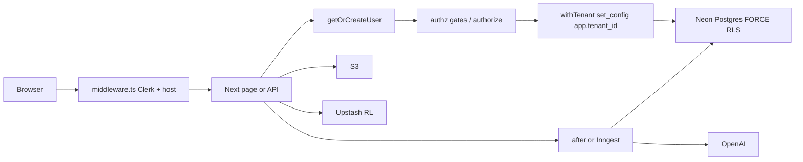
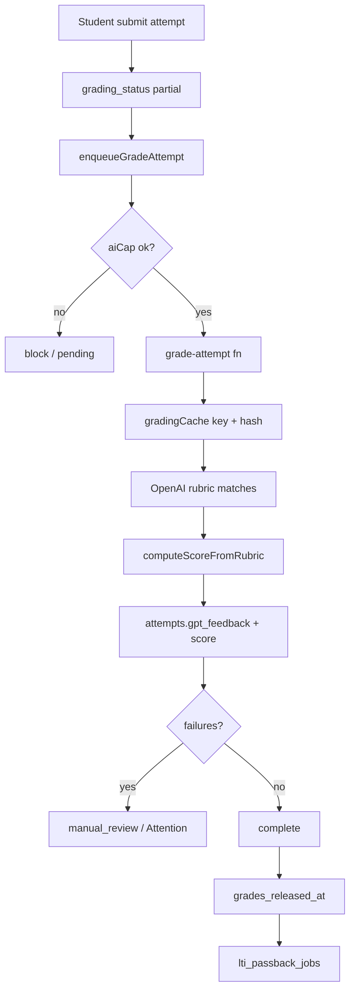
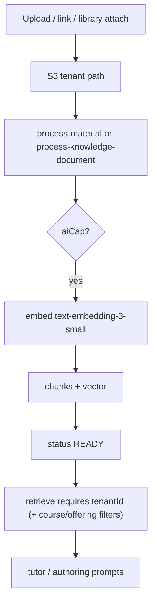
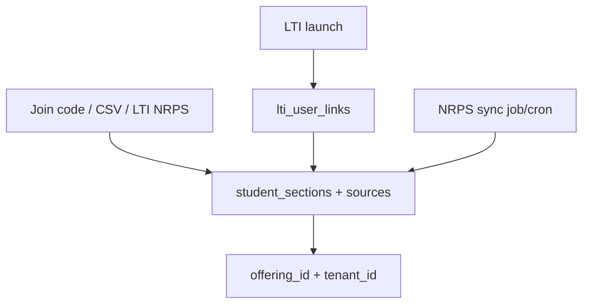
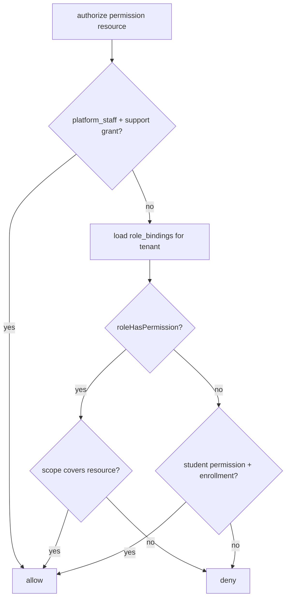

# SOL product walkthrough (as built)

**Date:** 2026-11-04  

**Mode:** read-only of application code/schema; data writes only on throwaway Neon branch `walkthrough-2026-11-04` (`br-wild-glade-b7kvo101`, parent `br-proud-bar-b7epjh2y` / sol-knowledge-dev).  

**App run:** `npm run dev` on `http://localhost:3000` (host rewrite to `app.localhost:3000`) with `.env.local` temporarily pointed at the throwaway branch (`sol_app`). `JOBS_BACKEND=inngest`; `npm run jobs:dev` started.  

**Seed:** `scripts/seed-dev.ts` failed mid-run (missing `tenant_id`/`offering_id` on inserts — script lag). Remaining fixtures inserted via SQL on the throwaway branch only.  

**Auth for UI smoke:** Clerk dev users `*+walkthrough@example.com` / password `Walkthrough!Seed1`, linked to seed `users` rows by updating `clerk_id`+`email` on the throwaway branch. Instructor desk observed signed-in.  

**Evidence rule:** every claim cites `file:line`, a route, or a run observation. Unconfirmed items are marked **unverified** with reason.

**Code audit agents (read-only):** [Explore stack](fbf741f2-7539-44d8-8074-ee0d8ba21b57), [Explore authz](b04619fd-a0b4-4031-8ac6-92468f91b92f), [Explore modules](0cdcb6b0-ccbc-4ca4-93c4-4c80b46ce67e). Authz/retrieve claims below incorporate their corrections (`authorize` + bindings as live gate; `users.role` dropped; retrieve requires `tenantId`).

## 1. System overview

### 1.1 Stack and services

| Layer | What the code uses | Evidence |
| --- | --- | --- |
| App | Next.js 15.3.8 App Router (dev log: “Next.js 15.3.8”), React 19, Tailwind | `package.json`; terminal `445500` Ready log |
| DB | Neon Postgres via Drizzle + `@neondatabase/serverless` Pool | `app/db/index.ts`; `lib/env.ts` `DATABASE_URL` |
| Auth | Clerk (`@clerk/nextjs`); session at Edge middleware | `middleware.ts`; login UI “Secured by Clerk · Development mode” |
| AI | OpenAI only — grading `gpt-5-mini-2025-08-07`, tutor `gpt-4.1-mini`, authoring `gpt-4o-mini` (or `OPENAI_AUTHORING_MODEL`), embeddings `text-embedding-3-small` | `lib/gradingTypes.ts:81`, `lib/chatbot/constants.ts:2`, `lib/authoring/constants.ts:5-6`, `lib/knowledge/constants.ts:37` |
| Files | AWS S3 (`lib/knowledge/storage.ts`, `lib/interactives/storage.ts`); Textract OCR path exists | env had `AWS_S3_BUCKET`/`AWS_REGION` locally |
| Cache / RL | Upstash Redis (`lib/rateLimit.ts`); in-memory fallback | `lib/env.ts` |
| Jobs | `JOBS_BACKEND` `after`\|`inngest` (default `after` in schema; local env was `inngest`) | `lib/env.ts:71`, `lib/jobs/enqueue.ts`, `lib/jobs/functions.ts` |
| Payments | Stripe Checkout + webhooks; paywall gated by `NEXT_PUBLIC_PAYMENTS_ENABLED` | `lib/featureFlags.ts`, `app/api/stripe/*` |
| Observability | Sentry + optional Braintrust | `sentry.*.ts`, `lib/ai/tracing.ts` |
| LMS | LTI 1.3 (OIDC launch, NRPS, AGS passback) behind feature flags | `lib/lti/*`, `app/lti/bridge/page.tsx` |

### 1.2 Deploy targets / environments

- Two Vercel projects documented: StratOps (`strat-ops.net`, optional `/learning` base path, **owns crons**) and teachwithsol (empty base path, host routing via `NEXT_PUBLIC_SOL_*_HOST`). Evidence: `PRODUCTION_DEPLOY.md:11-41`.

- Local/dev: `DEV_DB_HOSTS` allowlist + `assertDevDatabaseHost` refuse non-allowlisted hosts (`lib/env.ts:243-265`). Scripts also require `I_CONFIRM_DEV_DB=1` (`scripts/lib/assertDevDatabase.ts`).

- This walkthrough used throwaway branch host `ep-rough-wave-b7tobmlt-pooler.c-13.us-east-1.aws.neon.tech` added to `DEV_DB_HOSTS`.

- **unverified:** which Neon branch production uses and whether all migrations are applied there (ops outside this run).

### 1.3 Background jobs

Inngest functions (`lib/jobs/functions.ts`):

| id | event / cron | concurrency |
| --- | --- | --- |
| `grade-attempt` | `grading/attempt.requested` | global 20 + per `tenantId` 10; retries 3 |
| `grade-attempts-batch` | `grading/attempts.batch.requested` | global 5 + per tenant 3 |
| `process-material` | `knowledge/material.process` | 8 / 4 |
| `process-knowledge-document` | `knowledge/document.process` | 6 / 3 |
| `sync-knowledge-connector` | `knowledge/connector.sync` | 4 / 1 |
| `process-book` | `books/book.process` | 4 / 2 |
| `lti-passback-drain` | `lti/passback.drain` | 4 |
| `analytics-rollups` | cron `0 6 * * *` | 2 |
| `chatbot-session-retention` | cron `0 3 * * 0` | 1 |

Enqueue prefers Inngest when `JOBS_BACKEND=inngest`, else Next `after()`; send failures fall back to `after()` (`lib/jobs/enqueue.ts`). Vercel crons (grade-pending, process-materials, lti-roster, lti-passback) are a safety net — emitted only for StratOps base-path builds (`scripts/write-vercel-json.mjs` / `PRODUCTION_DEPLOY.md`).

Observed: `PUT /api/inngest 200` repeatedly while dev server ran (terminal `445500`).

### 1.4 Request path

1. Edge `middleware.ts`: Clerk session + Sol host rewrite/redirect (`classifySolHost`).

2. Node page/API: `getOrCreateUser` upserts/relinks by `clerk_id` or email (`lib/getOrCreateUser.ts:164-261`).

3. Gate: `requireTeachingAccess` / `requireLearningAccess` / `requireWorkspaceAdminAccess` / `requirePlatformStaff` / `requirePermission` (`lib/authz/gates.ts`). Teaching area is **binding-based**. `shadowCompare` still logs disagreements vs deprecated legacy teaching-role helpers (`gates.ts:73-89`; `lib/authz/shadowAuthorize.ts`). Observed: `authz.shadow_mismatch` for instructor (`legacy:false, next:true`) — expected when seed users have no deprecated `users.role` value.

4. Active workspace: cookie `sol_workspace_id` or sole membership (`lib/workspace/activeWorkspace.ts:7-22`).

5. Data access: many paths use DEFINER helpers / `withTenant` setting `app.tenant_id` via `set_config(..., true)` (`lib/db/tenantContext.ts:15-47`). FORCE RLS predicates compare row `tenant_id` to GUC.

6. Slow AI work: enqueue job → Inngest/`after` → OpenAI → write result.

7. Response: HTML/JSON.

### 1.5 Data model summary

Organizations are `workspaces` (types creator/department/institution; optional `parent_workspace_id`). There is no separate `organizations` table. Soft structure: course → `course_offerings` → `sections`. Enrollments: `student_sections` (+ `sources` jsonb), staff via `professor_sections` and/or `role_bindings`. Content: `quizzes`/`questions`/`quiz_sections`, `chatbots`/`chatbot_*`, `course_materials` + `knowledge_documents`/`course_knowledge_links`, `interactives`, `lessons`. Grades live on `attempts` (+ `grade_overrides`, `regrade_requests`). Audit: `audit_log`.

**Live FORCE RLS + `tenant_id` inventory** (query on throwaway branch 2026-11-04):

- Almost all teaching tables: `FORCE RLS = true` and `tenant_id` present (courses, sections, offerings, quizzes, questions, attempts, assignments, chatbots*, materials*, knowledge*, authoring*, analytics_rollups, grade_overrides, regrade_requests, quiz_versions, audit_log, role_bindings, support_access_grants, LTI tables, etc.).

- Workspace-scoped tables with FORCE RLS but **no** `tenant_id` column (policies use `workspace_id`): `workspaces`, `workspace_memberships`, `workspace_licenses`, `workspace_invites`, `workspace_usage_daily`.

- **No RLS:** `users`, `clerk_events`, `stripe_events`.

- Note: Nov 2 audit listed several of these as gaps; on this branch they now have FORCE RLS + `tenant_id` (grade_overrides, regrade_requests, quiz_versions, audit_log, knowledge satellites).

## 2. System design principles as implemented

| Principle | Status | Evidence / exceptions |
| --- | --- | --- |
| Tenant is the only hard wall | **Followed** for FORCE RLS tables | Live inventory; `withTenant` `lib/db/tenantContext.ts:15-47`. Exception: `users` global; webhook tables unprotected. |
| `authorize` as single gate | **Mostly** | Desk gates and quiz access go through bindings/`authorize` (`lib/authz/authorize.ts`, `lib/quizAccess.ts`, `lib/authz/courseAccess.ts`). Residual: `professorId` still stored as creator metadata and used in some list/join filters (`professor_sections.professorId`); not the primary allow/deny for teaching desks. |
| Scoped roles | **Partial** | `role_bindings` roles/scopes CHECK constraints (organization/department/offering/section). Seed bindings worked for lead_instructor/ta/owner. Students via `student_sections` only. |
| AI proposes / instructor decides | **Followed** in authoring | Authoring chat proposes; publish/release are separate actions. Observed authoring empty-state “Propose outline”. |
| Code computes scores | **Followed** | `computeScoreFromRubric` `lib/gradingRubric.ts:130`; used in `lib/grading.ts:588` and overrides `lib/professor/overrides.ts:206`. |
| Async jobs, idempotent, per-tenant fair | **Mostly** | Inngest concurrency keys; enqueue AI-cap check. Idempotency of every job path **unverified** end-to-end in this run. |
| Versions stored per grade | **Partial** | Cache key includes rubric/model/materials hash (`lib/gradingCache.ts:4,56-62`). Attempt `gpt_feedback` stores model/rubric versions in seed shape. Full materials-hash invalidation E2E **unverified**. |
| Metering and caps before AI | **Partial** | `checkAiBandAvailable` called from enqueue/grading/authoring/knowledge process. Owner notification / queue-at-cap UX **unverified**. |
| Degrade to manual path | **Followed** | Pending → manual_review after failures (`lib/gradingTypes.ts`, attention desk UI observed “Nothing in the queue”). |
| Audit education records | **Partial** | `audit_log` FORCE RLS + tenant; append-only historically. Admin/workspace audit viewers exist as routes. Completeness of every grade/export read **unverified**. |
| Tenant in every key | **Partial** | Knowledge S3 uses `tenants/{tenantId}/…` (plus legacy `courses/…` paths) (`lib/knowledge/storage.ts`). Retrieve **requires `tenantId`** (`lib/knowledge/retrieve.ts:29-52`). Interactives may still use course-prefixed S3 paths (**unverified** migration completeness). Rate limits often user-scoped. |

## 3. Roles and access

### 3.1 How roles are created

| Role | How created today | Sees / can | Cannot |
| --- | --- | --- | --- |
| Owner | `role_bindings` role `owner` @ `organization` (+ membership seat) | Workspace billing/invites/audit when `authorize`/`userCanManageWorkspaceBilling` | Student answers unless separately teaching |
| Admin | binding `admin` @ org/dept | People/policy/caps (UI under workspace/admin) | — |
| Faculty | binding `faculty` / invites | Catalog / create courses (entitlement) | Student work |
| Lead / co-instructor | binding on offering/section | Teach content, grades | Co cannot remove lead (invariant in ownership helpers) |
| TA / grader | binding on section (+ optional `professor_sections`) | Grade assigned sections; `/dashboard/ta` | Publish/rubrics (permission catalog) |
| Student | `student_sections` enrollment | Own work, tutor, grades | Other students |
| Platform staff | `users.platform_staff` | Admin surfaces via `requirePlatformStaff` | Tenant data needs `support_access_grants` (`authorize` + `platformStaffHasTenantDataAccess`) |

Observed: instructor with `lead_instructor` binding reached `/dashboard/professor` despite no legacy teaching role → shadow mismatch log.

### 3.2 Legacy fields after bindings cutover

- **`users.role`:** removed from the Drizzle model; DB column deprecated/dropped via `drizzle/0044_drop_users_role.sql`. `check:legacy-authz` → `legacy_authz_count=0`. Remaining use is **shadow logging only** (`lib/authz/shadowAuthorize.ts`, optional `LEGACY_ADMIN_ROLE_FALLBACK` in `getOrCreateUser`).

- **`professorId`:** still a creator/ownership column on quizzes/chatbots/lessons (~170 identifier hits). Create paths authorize via bindings then stamp `professorId: user.id` (`lib/professor/mutations.ts`). Access checks such as `professorCanAccessQuiz` use `authorize` / offering scope (`lib/quizAccess.ts`), not `quiz.professorId === user.id`.

- **`workspace_memberships.role`:** seat-only (`member`); writers ignore elevated seat roles (`lib/workspace/access.ts` / `drizzle/0043`). Power is `role_bindings`.

- **MCP / PATs:** teaching-area required for MCP (`lib/api/mcpAuth.ts`); full token∩bindings matrix **unverified** in this run.

## 4. Every page and screen

There are **98** `page.tsx` routes and **145** `app/api/**/route.ts` handlers (inventory `.tmp-walkthrough/`). Below: grouped inventory. Layout/data/actions detailed for pages that were opened; others summarized from code gates.

### 4.1 Entry / claim / payment

**Gate (typical):** Clerk for login/signup; claim pages token-gated; LTI bridge for LMS

**Observed this run:** Login and email/password sign-in worked for instructor; redirected to `/dashboard` then professor desk.

| URL | Notes |
| --- | --- |

| `/login` | see gate; denial → login/onboarding/other desk |

| `/lti/bridge` | see gate; denial → login/onboarding/other desk |

| `/onboarding` | see gate; denial → login/onboarding/other desk |

| `/payment` | see gate; denial → login/onboarding/other desk |

| `/signup` | see gate; denial → login/onboarding/other desk |

| `/staff/claim` | see gate; denial → login/onboarding/other desk |

| `/workspaces/claim` | see gate; denial → login/onboarding/other desk |

### 4.2 Professor / instructor

**Gate (typical):** `requireTeachingAccess` (bindings)

**Observed this run:** Desk “Ira’s desk”, Seed CS 101 sections A/B, 80% average, Sam Alpha 80% submission, Attention empty, Materials shows Seed Syllabus Ready, Authoring chat with Previous chats + Propose.

| URL | Notes |
| --- | --- |

| `/dashboard/professor/agent-access` | see gate; denial → login/onboarding/other desk |

| `/dashboard/professor/analytics/[courseId]` | see gate; denial → login/onboarding/other desk |

| `/dashboard/professor/analytics` | see gate; denial → login/onboarding/other desk |

| `/dashboard/professor/assignments` | see gate; denial → login/onboarding/other desk |

| `/dashboard/professor/attempt/[attemptId]` | see gate; denial → login/onboarding/other desk |

| `/dashboard/professor/attention` | see gate; denial → login/onboarding/other desk |

| `/dashboard/professor/authoring/[courseId]` | see gate; denial → login/onboarding/other desk |

| `/dashboard/professor/authoring` | see gate; denial → login/onboarding/other desk |

| `/dashboard/professor/courses/[courseId]/analytics` | see gate; denial → login/onboarding/other desk |

| `/dashboard/professor/courses/[courseId]/assignments` | see gate; denial → login/onboarding/other desk |

| `/dashboard/professor/courses/[courseId]/authoring` | see gate; denial → login/onboarding/other desk |

| `/dashboard/professor/courses/[courseId]/insights` | see gate; denial → login/onboarding/other desk |

| `/dashboard/professor/courses/[courseId]/materials` | see gate; denial → login/onboarding/other desk |

| `/dashboard/professor/courses/[courseId]` | see gate; denial → login/onboarding/other desk |

| `/dashboard/professor/courses/[courseId]/sections` | see gate; denial → login/onboarding/other desk |

| `/dashboard/professor/courses` | see gate; denial → login/onboarding/other desk |

| `/dashboard/professor/discussions/[id]/edit` | see gate; denial → login/onboarding/other desk |

| `/dashboard/professor/discussions/[id]` | see gate; denial → login/onboarding/other desk |

| `/dashboard/professor/discussions/new` | see gate; denial → login/onboarding/other desk |

| `/dashboard/professor/discussions` | see gate; denial → login/onboarding/other desk |

| `/dashboard/professor/discussions/session/[sessionId]` | see gate; denial → login/onboarding/other desk |

| `/dashboard/professor/interactive/[id]/edit` | see gate; denial → login/onboarding/other desk |

| `/dashboard/professor/interactive/import` | see gate; denial → login/onboarding/other desk |

| `/dashboard/professor/interactive/new` | see gate; denial → login/onboarding/other desk |

| `/dashboard/professor/materials/[courseId]` | see gate; denial → login/onboarding/other desk |

| `/dashboard/professor/materials` | see gate; denial → login/onboarding/other desk |

| `/dashboard/professor` | see gate; denial → login/onboarding/other desk |

| `/dashboard/professor/quiz-results` | see gate; denial → login/onboarding/other desk |

| `/dashboard/professor/quiz/[quizId]/calibration` | see gate; denial → login/onboarding/other desk |

| `/dashboard/professor/quiz/[quizId]/edit` | see gate; denial → login/onboarding/other desk |

| `/dashboard/professor/quiz/[quizId]/results` | see gate; denial → login/onboarding/other desk |

| `/dashboard/professor/quiz/new` | see gate; denial → login/onboarding/other desk |

| `/dashboard/professor/quizzes` | see gate; denial → login/onboarding/other desk |

| `/dashboard/professor/sections/[sectionId]/gradebook` | see gate; denial → login/onboarding/other desk |

| `/dashboard/professor/sections/[sectionId]` | see gate; denial → login/onboarding/other desk |

| `/dashboard/professor/sections/archived` | see gate; denial → login/onboarding/other desk |

| `/dashboard/professor/sections` | see gate; denial → login/onboarding/other desk |

### 4.3 Student

**Gate (typical):** `requireLearningAccess` / enrollment

**Observed this run:** **unverified UI** this run (did not re-login as student). Routes exist under `/dashboard/student/*`.

| URL | Notes |
| --- | --- |

| `/dashboard/student/assignments` | see gate; denial → login/onboarding/other desk |

| `/dashboard/student/books/[bookId]/chapters/[chapterId]` | see gate; denial → login/onboarding/other desk |

| `/dashboard/student/books/[bookId]` | see gate; denial → login/onboarding/other desk |

| `/dashboard/student/calendar` | see gate; denial → login/onboarding/other desk |

| `/dashboard/student/discussions` | see gate; denial → login/onboarding/other desk |

| `/dashboard/student/grades` | see gate; denial → login/onboarding/other desk |

| `/dashboard/student/lessons/[id]` | see gate; denial → login/onboarding/other desk |

| `/dashboard/student/lessons` | see gate; denial → login/onboarding/other desk |

| `/dashboard/student` | see gate; denial → login/onboarding/other desk |

| `/dashboard/student/quizzes` | see gate; denial → login/onboarding/other desk |

| `/dashboard/student/sections/[sectionId]/assignments` | see gate; denial → login/onboarding/other desk |

| `/dashboard/student/sections/[sectionId]/books` | see gate; denial → login/onboarding/other desk |

| `/dashboard/student/sections/[sectionId]/grades` | see gate; denial → login/onboarding/other desk |

| `/dashboard/student/sections/[sectionId]` | see gate; denial → login/onboarding/other desk |

| `/dashboard/student/sections/[sectionId]/work` | see gate; denial → login/onboarding/other desk |

| `/dashboard/student/sections/archived` | see gate; denial → login/onboarding/other desk |

| `/dashboard/student/sections` | see gate; denial → login/onboarding/other desk |

### 4.4 TA

**Gate (typical):** `requireTeachingAccess` + TA bindings

**Observed this run:** **unverified UI** (ta user created, not signed in).

| URL | Notes |
| --- | --- |

| `/dashboard/ta` | see gate; denial → login/onboarding/other desk |

### 4.5 Platform admin

**Gate (typical):** `requirePlatformStaff`

**Observed this run:** **unverified UI**. Routes: tenants, users, workspaces, audit, LTI, quizzes, sections.

| URL | Notes |
| --- | --- |

| `/dashboard/admin/assignments` | see gate; denial → login/onboarding/other desk |

| `/dashboard/admin/audit` | see gate; denial → login/onboarding/other desk |

| `/dashboard/admin/courses` | see gate; denial → login/onboarding/other desk |

| `/dashboard/admin/lti` | see gate; denial → login/onboarding/other desk |

| `/dashboard/admin` | see gate; denial → login/onboarding/other desk |

| `/dashboard/admin/quizzes/new` | see gate; denial → login/onboarding/other desk |

| `/dashboard/admin/quizzes` | see gate; denial → login/onboarding/other desk |

| `/dashboard/admin/sections/[sectionId]/gradebook` | see gate; denial → login/onboarding/other desk |

| `/dashboard/admin/sections/[sectionId]` | see gate; denial → login/onboarding/other desk |

| `/dashboard/admin/sections/archived` | see gate; denial → login/onboarding/other desk |

| `/dashboard/admin/sections` | see gate; denial → login/onboarding/other desk |

| `/dashboard/admin/tenants` | see gate; denial → login/onboarding/other desk |

| `/dashboard/admin/users` | see gate; denial → login/onboarding/other desk |

| `/dashboard/admin/workspaces` | see gate; denial → login/onboarding/other desk |

### 4.6 Workspace owner/admin

**Gate (typical):** `requireWorkspaceAdminAccess` / billing entitlements

**Observed this run:** **unverified UI**. Routes: overview, usage, audit, knowledge, lti.

| URL | Notes |
| --- | --- |

| `/dashboard/workspace/audit` | see gate; denial → login/onboarding/other desk |

| `/dashboard/workspace/knowledge` | see gate; denial → login/onboarding/other desk |

| `/dashboard/workspace/lti` | see gate; denial → login/onboarding/other desk |

| `/dashboard/workspace` | see gate; denial → login/onboarding/other desk |

| `/dashboard/workspace/usage` | see gate; denial → login/onboarding/other desk |

### 4.7 Learner runtime (quiz/chatbot/interactive)

**Gate (typical):** Enrollment + assignment checks in page loaders

**Observed this run:** **unverified UI** this run.

| URL | Notes |
| --- | --- |

| `/chatbot/[chatbotId]` | see gate; denial → login/onboarding/other desk |

| `/interactive/[id]` | see gate; denial → login/onboarding/other desk |

| `/quiz/[quizId]` | see gate; denial → login/onboarding/other desk |

| `/quiz/[quizId]/results` | see gate; denial → login/onboarding/other desk |

| `/quiz/[quizId]/review` | see gate; denial → login/onboarding/other desk |

### 4.8 Public / marketing / legal

**Gate (typical):** Public (Clerk optional)

**Observed this run:** Marketing `/` and legal pages exist; host routing may rewrite.

| URL | Notes |
| --- | --- |

| `/blog/[slug]` | see gate; denial → login/onboarding/other desk |

| `/blog` | see gate; denial → login/onboarding/other desk |

| `/dmca` | see gate; denial → login/onboarding/other desk |

| `/docs/[slug]` | see gate; denial → login/onboarding/other desk |

| `/docs` | see gate; denial → login/onboarding/other desk |

| `/` | see gate; denial → login/onboarding/other desk |

| `/privacy` | see gate; denial → login/onboarding/other desk |

| `/security` | see gate; denial → login/onboarding/other desk |

| `/terms` | see gate; denial → login/onboarding/other desk |

| `/unsubscribe` | see gate; denial → login/onboarding/other desk |

**Unauthenticated denial:** `GET /dashboard/professor` without session → `307` to `app.localhost:3000/dashboard/professor` with `x-clerk-auth-status: signed-out` (curl -I). Login returns `307`/`200` depending on host cookie.

**Empty/loading/error:** Professor attention empty state observed (“Nothing in the queue.”). Authoring empty artifact (“No artifact yet”). Next.js overlay `TypeError: Cannot read properties of undefined (reading 'call')` appeared once during login HMR — recovered after refresh (**fragile**).

## 5. Workflows end to end

| Workflow | Status | Steps / evidence |
| --- | --- | --- |
| Plain sign-up | **partial** | `/signup` + Clerk; first-run `/onboarding`. Not exercised beyond login. |
| Invite claim | **unverified** | `/workspaces/claim` + `workspace_invites` | 
| Join code | **code** | Student enroll APIs + section codes `SEEDSA`/`SEEDSB` seeded | 
| LMS launch | **unverified** | Needs Canvas; code in `lib/lti/*`, `/lti/bridge` | 
| Faculty CSV | **unverified** | Import routes exist; not run | 
| Workspace create | **partial** | Seed created dept+personal workspaces + licenses + memberships | 
| Instructor materials | **pass (read)** | `/…/materials` listed Seed Syllabus Ready; upload not exercised (would hit S3) | 
| Author assignment | **partial** | Authoring UI ready (1/1 materials); propose not clicked (would call OpenAI) | 
| Publish/release | **code** | Authoring publish/release APIs; quiz `grades_released_at` set in seed SQL | 
| Student take quiz | **unverified UI** | Seed attempt exists (80%); take flow not driven | 
| Autosave/submit | **code** | Quiz client + attempt APIs | 
| Feedback / regrade | **code** | `regrade_requests` table FORCE RLS; UI not driven | 
| Grading pipeline | **code + jobs** | enqueue → Inngest `grade-attempt` → `gradePendingForAttemptId`; caps via `checkAiBandAvailable` | 
| Manual review / override | **UI partial** | Attention desk empty; override libs present | 
| LMS passback | **unverified** | `lti_passback_jobs` + drain fn | 
| Tutor session | **partial** | Seed chatbot session row; student UI not driven | 
| TA grading | **unverified UI** | TA binding+professor_sections seeded | 
| Rollover | **code** | Course hub “Copy from prior offering” disabled in UI when no prior; `lib/authoring/copyOffering.ts` | 
| Ownership transfer / staff invites | **code** | `lib/authz/ownership.ts`, `staffInvites`, `/staff/claim` | 
| Support access | **code** | `support_access_grants` + platform_staff user seeded | 
| Export | **code** | `app/api/workspace/export`, `student/export`, professor quiz CSV UI on desk | 
| Retention/deletion | **partial** | Chatbot retention job only (`lib/jobs/retention.ts`); full tenant delete **not built as product** | 

## 6. Module behavior

### Knowledge

- **Does:** upload/link/book → process job → chunks+embeddings → retrieve for tutor/authoring; workspace library + course links.

- **AI:** `text-embedding-3-small` direct OpenAI client (no unified gateway).

- **Jobs:** `process-material`, `process-knowledge-document`, `sync-knowledge-connector`.

- **Caps:** `checkAiBandAvailable` in process paths.

- **Observed:** Seed Syllabus READY linked to Seed CS 101.

- **Gaps:** dual stacks (course_materials + knowledge_documents) still both feed RAG. Retrieve now requires `tenantId` (`lib/knowledge/retrieve.ts`); offering-scoped filtering completeness still **partial**.

### Authoring

- **Does:** chat propose → approve/build → refine → publish/release; revisions; switch-up; previous chats (archived outlines).

- **AI:** `AUTHORING_MODEL` gpt-4o-mini default, direct client.

- **Observed:** Chats control, Propose outline, 1/1 materials ready.

- **Gaps:** propose not smoked (OpenAI cost); immutable publish enforcement uneven.

### Learning (tutor + activities)

- **Does:** chatbots/discussions, quizzes, interactives, lessons, books reader.

- **AI:** tutor `gpt-4.1-mini`.

- **Retention:** weekly Inngest cron deletes old sessions when `settings.retentionDays` set.

- **Gaps:** assessment-mode lock / citation completeness **unverified**.

### Assessment

- **Does:** short-answer grading with rubric matches → `computeScoreFromRubric`; pending/manual_review; overrides; attention queue; cache key with materials hash.

- **AI:** `gpt-5-mini-2025-08-07`.

- **Jobs:** grade-attempt / batch; cron grade-pending safety net.

- **Observed:** seed attempt 80% on professor desk; attention empty.

### Analytics

- **Does:** rollups table + Inngest daily cron; course analytics/insights pages; k-anonymity helpers (`lib/analytics/kAnonymity.ts`).

- **Gaps:** suggestions→authoring loop **unverified**; rollup freshness not checked.

### Connectors / LTI

- **Does:** LTI 1.3 launch/roster/passback tables + jobs; workspace LTI page; admin LTI.

- **Gaps:** dynamic registration stub historically; **unverified** live Canvas.

### MCP / API

- **Does:** professor MCP tools + PAT scopes (`lib/mcp/*`, agent-access page).

- **Gaps:** token ∩ bindings vs global role cutover **unverified**.

### Billing / caps

- **Does:** workspace licenses, usage daily, Stripe checkout routes, `aiCapGuard` before many AI paths.

- **Gaps:** paywall default off; full owner notify/upgrade loop **unverified**.

### Ops (audit, export, retention, support)

- Export APIs exist (workspace/student/quiz). Retention = chatbot sessions (+ optional gpt_feedback purge). Support grants table + platform_staff. Audit FORCE RLS.

- Gaps: tenant-wide deletion product; encryption-on-by-default; WCAG CI absent (`next lint` failed: eslint not installed).

## 7. Data flow diagrams

## 8. Health check

| Check | Result | Notes |
| --- | --- | --- |
| `npm run lint` | **fail / blocked** | `ESLint must be installed` |
| `npm run typecheck` | **fail** | **59** `error TS` (pre-existing across LTI/admin/workspace/tests) |
| `npm test` | **fail** | 9 failed / 511 passed / 16 skipped / 4 todo (93 files). Failures include factories missing `tenant_id`/`offering_id` on quizzes/sections; broken `shadowAuthorize` test expectations |
| `npm run test:isolation` | **partial** | **55 passed**, 16 skipped; **4 files failed** seeding fixtures (`offering_id` NOT NULL on sections) when pointed at walkthrough DB |
| `npm run check:tenant-schema` | **pass** (on `TEST_DATABASE_URL` test host wispy-recipe) | Script prefers `TEST_DATABASE_URL` over walkthrough `DATABASE_URL` |
| `npm run check:legacy-authz` | **pass** | `legacy_authz_count=0` |

### Smoke notes (section 5)

- Instructor login + desk + course hub + materials + authoring + attention: **pass**.

- Student / TA / admin / LTI / Stripe / S3 upload / live grading call: **unverified** or code-only as above.

- Fragile: Next.js HMR runtime error overlay once; seed-dev script outdated vs NOT NULL tenant/offering columns; isolation factories lag schema.

- Behind flags: payments (`NEXT_PUBLIC_PAYMENTS_ENABLED`), LTI feature flags (**unverified** exact flag names in this pass).

## 9. Summary

### Works well

- Teaching desk with binding-based access (even when `users.role` empty).

- FORCE RLS + `tenant_id` coverage is broad on current Neon.

- Course hub IA (materials / authoring / assignments / sections / analytics).

- Deterministic scoring architecture + attention queue concept.

- Inngest wiring with per-tenant concurrency + local `after` fallback.

### Fragile

- Creator `professorId` metadata + `professor_sections` joins coexist with binding-based `authorize` (easy to confuse when reading code).

- Seed/test factories behind schema (blocks isolation suite on current DB).

- `seed-dev.ts` not usable as-is under FORCE RLS / NOT NULL tenant columns.

- Host routing (`app.localhost`) + dual Next processes during walkthrough.

- Typecheck debt (59 errors) and missing eslint package.

### Missing / half-built

- Consistent AI cap/notify UX across modules (`lib/ai/gateway.ts` present; product surface incomplete).

- Offering-owned content cutover (quizzes still stamp/list via `professorId`).

- Self-serve provisionWorkspace / TA-first UX / dynamic LTI registration.

- Complete export/retention/delete productization; WCAG CI.

- Student/TA/admin UI not smoked in this run.

### Top 10 issues (ranked)

1. **Test/seed drift** — factories & `seed-dev.ts` omit required `tenant_id`/`offering_id` → isolation suite red on current schema.

2. **Typecheck debt** — 59 TS errors hide regressions.

3. **No eslint in install** — `next lint` cannot run.

4. **Offering ownership incomplete** — quizzes/chatbots still carry `professorId` as primary ownership column; rollover/copy harder.

5. **Knowledge dual-stack** — `course_materials` + `knowledge_documents` both in play.

6. **No single product AI gateway UX** — `lib/ai/gateway.ts` exists for timeouts/budget, but modules still call OpenAI with uneven cap/notify paths.

7. **LTI self-serve registration** — still ops-heavy / historically stubbed.

8. **Ops product gaps** — retention limited to chatbot sessions; tenant delete unclear.

9. **Interactives S3 tenant prefix** — may still use course-scoped keys alongside knowledge tenant paths.

10. **Shadow mismatch noise** — `authz.shadow_mismatch` fires for binding-only teachers (observed); operators may misread it as an auth bug.

## Appendix A — Walkthrough environment

- Neon project `super-bar-83717363`, throwaway branch `walkthrough-2026-11-04` / `br-wild-glade-b7kvo101` — **deleted** after the run. Local `.env.walkthrough.local` / walkthrough `DATABASE_URL` override removed; shared `.env.local` restored.

- Clerk users left on **dev** instance (delete or rotate when convenient): `dept-owner+walkthrough@example.com`, `instructor+walkthrough@example.com`, `ta+walkthrough@example.com`, `personal+walkthrough@example.com`, `student-a+walkthrough@example.com`, `student-b+walkthrough@example.com`, `platform-staff+walkthrough@example.com`.

- Password used for smoke: `Walkthrough!Seed1`.

- Seed tenant dept `1be1ce85-a41a-4fcb-9c60-f926e8fbccf6`, course `9438991d-cc12-4be5-b638-5a784988e104`, codes `SEEDSA`/`SEEDSB`.

## Appendix B — Page route inventory (98)

- `/blog/[slug]`
- `/blog`
- `/chatbot/[chatbotId]`
- `/dashboard/admin/assignments`
- `/dashboard/admin/audit`
- `/dashboard/admin/courses`
- `/dashboard/admin/lti`
- `/dashboard/admin`
- `/dashboard/admin/quizzes/new`
- `/dashboard/admin/quizzes`
- `/dashboard/admin/sections/[sectionId]/gradebook`
- `/dashboard/admin/sections/[sectionId]`
- `/dashboard/admin/sections/archived`
- `/dashboard/admin/sections`
- `/dashboard/admin/tenants`
- `/dashboard/admin/users`
- `/dashboard/admin/workspaces`
- `/dashboard/home`
- `/dashboard`
- `/dashboard/professor/agent-access`
- `/dashboard/professor/analytics/[courseId]`
- `/dashboard/professor/analytics`
- `/dashboard/professor/assignments`
- `/dashboard/professor/attempt/[attemptId]`
- `/dashboard/professor/attention`
- `/dashboard/professor/authoring/[courseId]`
- `/dashboard/professor/authoring`
- `/dashboard/professor/courses/[courseId]/analytics`
- `/dashboard/professor/courses/[courseId]/assignments`
- `/dashboard/professor/courses/[courseId]/authoring`
- `/dashboard/professor/courses/[courseId]/insights`
- `/dashboard/professor/courses/[courseId]/materials`
- `/dashboard/professor/courses/[courseId]`
- `/dashboard/professor/courses/[courseId]/sections`
- `/dashboard/professor/courses`
- `/dashboard/professor/discussions/[id]/edit`
- `/dashboard/professor/discussions/[id]`
- `/dashboard/professor/discussions/new`
- `/dashboard/professor/discussions`
- `/dashboard/professor/discussions/session/[sessionId]`
- `/dashboard/professor/interactive/[id]/edit`
- `/dashboard/professor/interactive/import`
- `/dashboard/professor/interactive/new`
- `/dashboard/professor/materials/[courseId]`
- `/dashboard/professor/materials`
- `/dashboard/professor`
- `/dashboard/professor/quiz-results`
- `/dashboard/professor/quiz/[quizId]/calibration`
- `/dashboard/professor/quiz/[quizId]/edit`
- `/dashboard/professor/quiz/[quizId]/results`
- `/dashboard/professor/quiz/new`
- `/dashboard/professor/quizzes`
- `/dashboard/professor/sections/[sectionId]/gradebook`
- `/dashboard/professor/sections/[sectionId]`
- `/dashboard/professor/sections/archived`
- `/dashboard/professor/sections`
- `/dashboard/student/assignments`
- `/dashboard/student/books/[bookId]/chapters/[chapterId]`
- `/dashboard/student/books/[bookId]`
- `/dashboard/student/calendar`
- `/dashboard/student/discussions`
- `/dashboard/student/grades`
- `/dashboard/student/lessons/[id]`
- `/dashboard/student/lessons`
- `/dashboard/student`
- `/dashboard/student/quizzes`
- `/dashboard/student/sections/[sectionId]/assignments`
- `/dashboard/student/sections/[sectionId]/books`
- `/dashboard/student/sections/[sectionId]/grades`
- `/dashboard/student/sections/[sectionId]`
- `/dashboard/student/sections/[sectionId]/work`
- `/dashboard/student/sections/archived`
- `/dashboard/student/sections`
- `/dashboard/ta`
- `/dashboard/workspace/audit`
- `/dashboard/workspace/knowledge`
- `/dashboard/workspace/lti`
- `/dashboard/workspace`
- `/dashboard/workspace/usage`
- `/dmca`
- `/docs/[slug]`
- `/docs`
- `/interactive/[id]`
- `/login`
- `/lti/bridge`
- `/onboarding`
- `/`
- `/payment`
- `/privacy`
- `/quiz/[quizId]`
- `/quiz/[quizId]/results`
- `/quiz/[quizId]/review`
- `/security`
- `/signup`
- `/staff/claim`
- `/terms`
- `/unsubscribe`
- `/workspaces/claim`
