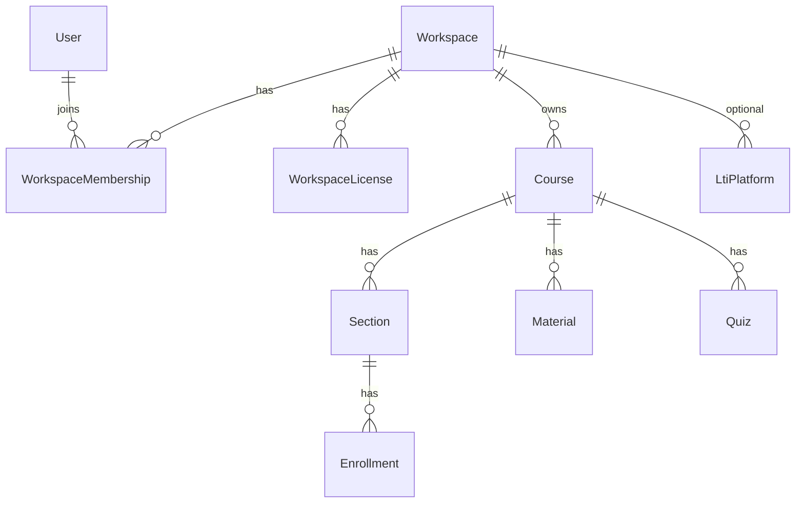
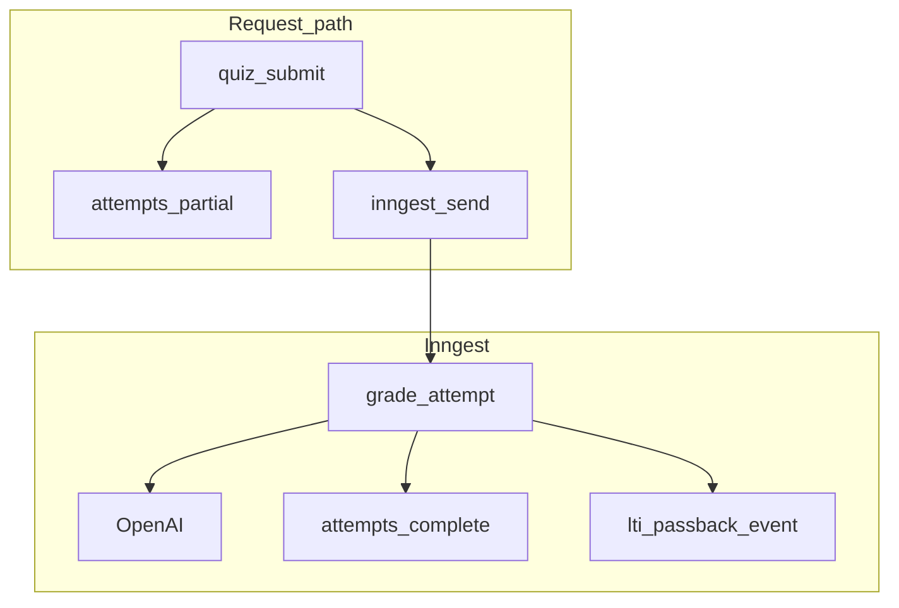

# SOL scale and tenancy design

Canonical engineering design for multi-segment monetization and production scale.
Product loop stays the same; **tenancy + billing + jobs** absorb growth.

**Stack (unchanged):** Next.js App Router · Neon Postgres · Vercel · S3 · Clerk · Upstash · OpenAI  
**Jobs:** Inngest (local Dev Server + Cloud in production)  
**Related plan:** multi-campus scale foundation (workspace-first)

**Rollout constraint (current):** Implement and migrate **only on local** (`npm run dev`) against the **local/dev Neon** URL in `.env.local`. Do **not** deploy these changes to teachwithsol/StratOps production or run migrations against prod Postgres until explicitly approved.

**Implemented (local/dev):** Inngest job layer (`lib/jobs/*`, `/api/inngest`, `JOBS_BACKEND`), migrations `0021`–`0023` (workspaces, usage, invites), seat caps on student enroll, **client-owned onboarding** (admin provisions + owner claim + owner Stripe), professor course create scoped to workspace membership.

### Owner-led onboarding (local)

1. Platform `ADMIN` (SOL company only) creates a workspace with type, tier, and **owner email** → license + claim link (`/workspaces/claim?token=…`).
2. Owner signs in with that email, claims → `workspace_memberships.role=owner`, global role at least `PROFESSOR` (never `ADMIN`).
3. **Creator / Business:** owner completes Stripe Checkout from `/dashboard/workspace` (test keys locally). Course create blocked until subscription is active.
4. **Department / Institution:** manual license already `active`; owner creates courses immediately.
5. Faculty/students still join via **section enrollment codes** under courses in that workspace.

Claim tokens live in `workspace_invites` (hash only). Admin no longer clicks Subscribe — billing is owner-only.

---

## 1. Commercial model (four SKUs, one product)

| SKU | Buyer | Sales motion | Who is free | Charge on |
| --- | --- | --- | --- | --- |
| **Creator** | Individual selling / running a course | Self-serve Stripe subscription | Learners (unless creator enables paid enroll) | Creator plan + optional per-learner |
| **Business** | L&D / company training | Self-serve or sales-assist | Employees as learners | Active learners / year (team tiers) |
| **Department** | Chair / CTL / school | Demo → pilot → annual PO | Faculty + students | Active enrolled students / year |
| **Institution** | Provost / IT / system | Enterprise sales + DPA | Faculty + students | Seat bands across campuses + LTI/SSO |

AI cost (tutor, SA grading, embeds) is priced via **active learners** and an **included AI band**, not faculty seats alone.

Student one-time Stripe (`users.paid`) stays **off** for campus SKUs. It may later back **Creator paid enrollment** only.

Marketing: Book a demo for Department/Institution; self-serve CTAs for Creator/Business when those SKUs ship.

---

## 2. Domain model: Workspace (not “campus-only”)

One tenant type covers all four SKUs.



### `workspaces`
| Column | Notes |
| --- | --- |
| `id` | UUID |
| `slug` | Unique public/internal key |
| `name` | Display name |
| `type` | `creator` \| `business` \| `department` \| `institution` |
| `status` | `trial` \| `active` \| `suspended` \| `churned` |
| `parentWorkspaceId` | Nullable. Institution → child department workspaces |
| `settings` | JSONB (features, branding later) |
| timestamps | created/updated |

**Institution hierarchy:** an `institution` workspace may own child `department` workspaces. Courses hang off the leaf workspace that teaches (usually department). Creator/Business are flat (no children).

### `workspace_memberships`
| Column | Notes |
| --- | --- |
| `workspaceId`, `userId` | Unique pair |
| `role` | `owner` \| `admin` \| `instructor` \| `learner` |
| `status` | `active` \| `invited` \| `removed` |

Maps onto today’s global `users.role` gradually: platform `ADMIN` remains SOL operator; teaching roles are **membership-scoped**.

### `workspace_licenses`
| Column | Notes |
| --- | --- |
| `workspaceId` | One current license row (or versioned history) |
| `plan` | `creator` \| `business_team` \| `department` \| `institution` |
| `seatCap` | Max **active learners** in the billing period |
| `aiUnitCap` | Soft/hard included AI units (grades + tutor turns + embeds) |
| `periodStart` / `periodEnd` | Annual or monthly |
| `billingProvider` | `manual` \| `stripe` |
| `stripeCustomerId` / `stripeSubscriptionId` | Nullable |
| `status` | `trialing` \| `active` \| `past_due` \| `canceled` |

**Entitlement rule:** a learner may use the product if their workspace license is active and under seat/AI caps — **not** via `users.paid` for B2B.

### Courses and inheritance
- Add `workspaceId` on `courses` (required after backfill).
- Sections, quizzes, materials, chatbots stay course-scoped (inherit workspace via course).
- Enrollment codes uniqueness → **per workspace** (not global), when migrated.
- `lti_platforms.workspaceId` — one or more platforms per institution/department workspace.

### Backfill
1. Create workspace `type=institution` (or `department`) slug `default` / pilot name.  
2. Attach all existing courses + memberships from current enrollments.  
3. License: generous trial/active so nothing breaks.  
4. Keep `users.paid` readable; stop using it when `PAYMENTS_ENABLED` stays false.

---

## 3. Authorization

```text
request → Clerk session → SOL user
       → resolve active workspace (cookie / membership / course context)
       → assert membership role
       → load course only if course.workspaceId === active (or ancestor institution)
```

Central helpers (to add):
- `requireWorkspace(role)`
- `assertCourseInWorkspace(courseId, workspaceId)`
- `assertUnderSeatCap(workspaceId)` before new learner enrollment

Platform super-admin bypasses workspace filters for support.

**Data isolation:** app-level filters first (every list/get by `workspaceId`). Postgres RLS is a later hardening step, not required for v1.

---

## 4. Billing flows by SKU

| SKU | Checkout | Seat enforcement |
| --- | --- | --- |
| Creator | Stripe Checkout **subscription** on workspace | Cap courses + active learners |
| Business | Stripe subscription or invoice | Cap active learners |
| Department | Invoice / Stripe Invoicing; sales-led | Cap active learners; pilot flag |
| Institution | Invoice + contract; child dept rollup | Cap at institution; allocate to depts |

Usage metering (for AI band): increment counters on tutor message, SA grade, embed batch — store daily rollups per `workspaceId` (table `workspace_usage_daily`). Soft warn at 80%; hard block or overage only when product policy says so.

### Draft list prices (modeled in code)

Source of truth for local planning: [`lib/workspace/pricing.ts`](../../lib/workspace/pricing.ts) (`WORKSPACE_PRICING_CATALOG`, `quoteWorkspace`). **Not** live Stripe amounts until Price IDs are pinned.

| SKU | Example tiers (list) | Seats | AI units | Motion |
| --- | --- | ---: | ---: | --- |
| Creator | $29 / $79 / $199 **per month** | 50 / 200 / 1k | 5k / 25k / 100k | Stripe |
| Business | $2.4k / $9k / $28k **per year** | 100 / 500 / 2k | 20k / 100k / 400k | Stripe → invoice |
| Department | $5k / $15k / $40k **per year** | 500 / 1.5k / 5k | 75k / 250k / 800k | Invoice (+ $/learner overage) |
| Institution | $25k / $75k / $250k **per year** | 2k / 10k / 50k | 400k / 2M / 10M | Invoice / MSA |

COGS helpers: `AI_UNIT_COGS_USD` + `quoteWorkspace({ sku, activeLearners, aiUnits })` for margin sketches. Admin workspace create applies the default tier’s `seatCap` / `aiUnitCap` when not overridden.

---

## 5. Runtime scale (jobs)

Heavy work must not live in the request or unbounded `after()`:

| Job | Event (Inngest) | Concurrency |
| --- | --- | --- |
| Grade pending attempt | `grading/attempt.requested` | Global OpenAI pool + `workspaceId` key |
| Process material | `knowledge/material.process` | Per workspace |
| LTI passback | `lti/passback.requested` | Per platform / workspace |
| Usage rollup / sweeps | cron | Single owner deploy |

**Local:** Next dev + Inngest Dev Server.  
**Prod:** Inngest Cloud; StratOps (or one designated project) is the **only** job consumer if dual-deploy shares one DB.

Feature flag: `JOBS_BACKEND=after|inngest` during rollout.



---

## 6. What stays the same

- Teaching loop: Knowledge → Authoring → Tutor → Assessment → Analytics  
- Neon as system of record; S3 for binaries; Clerk for identity  
- FERPA-minded defaults; no training on student work  
- Canvas LTI optional, never the product identity  
- Dual brand hosts (teachwithsol / StratOps) with empty vs `/learning` basePath  

---

## 7. Capacity posture

| Load | Design answer |
| --- | --- |
| Many workspaces | Rows in `workspaces`; indexes on `workspaceId` |
| Exam spike | Inngest concurrency + grading cache; Attention fallback |
| Multi-campus institution | Parent workspace + child departments; LTI per workspace |
| Creator viral growth | Seat/AI caps on Creator plan; self-serve Stripe |
| Analytics heavy | Keep on-read initially; add workspace-scoped rollups if slow |

**Not in v1:** separate DB per tenant, microservices, student marketplace as a storefront.

---

## 8. Implementation phases

1. **Jobs** — Inngest for grade / materials / LTI (throughput before schema).  
2. **Workspace schema** — tables + `courses.workspaceId` backfill + membership helpers.  
3. **Entitlement** — licenses + seat checks on enroll; retire student paywall for B2B.  
4. **SKU surfaces** — Creator/Business self-serve; Department/Institution admin + invoice fields.  
5. **Institution hierarchy** — parent/child workspaces + rolled-up seats.  
6. **Metering** — `workspace_usage_daily` + AI band enforcement.

---

## 9. Success criteria

- Two department workspaces cannot see each other’s courses.  
- An institution can own multiple departments with separate LTI platforms.  
- Creator and Business can exist in the same DB with Stripe-backed licenses.  
- Exam SA grading drains via Inngest without daily-cron dependence.  
- Local `npm run dev` + Inngest exercises the same job code as production.
