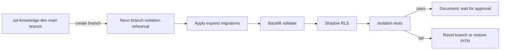

# Tenant isolation — inventory and migration plan

**Status:** Waves A–E isolation landed; **scoped role bindings** cutover applied on local/`sol-knowledge-dev` (`drizzle/0041_role_bindings.sql`). Membership is seat-only; authority is `role_bindings` + `student_sections`.  
**Scope:** local / **sol-knowledge-dev** Neon only. Synthetic seed data only. Do not copy or query production.  
**Date:** 2026-11-02 (bindings update same day)  
**Related:** [scale-and-tenancy.md](./scale-and-tenancy.md), [ARCHITECTURE_FOR_CLAUDE.md](../ARCHITECTURE_FOR_CLAUDE.md), [SOL How the Whole Platform Works.md](../../SOL%20How%20the%20Whole%20Platform%20Works.md)

This document is the single deliverable for: (1) a **dev-only DB guard** (implemented in scripts), (2) a **read-only inventory** of tenancy surface area, and (3) an **ordered expand→contract migration plan** (not executed).

---

## 0. Hard constraints (rehearsal rules)

| Rule | Detail |
| --- | --- |
| Database | Only hosts listed in `DEV_DB_HOSTS` (local/dev Neon). Never production. |
| Data | Synthetic seeds / factories only. No production dumps. |
| Migrations | **Add new** Drizzle SQL files only. Do not edit existing `drizzle/00*.sql`. |
| Apply | Do **not** run tenant migrations until this plan is reviewed and approved. |
| Deploy | Do not push schema/RLS to teachwithsol or StratOps as part of this work. |

---

## 1. Dev-only guard (Task 1 — implemented)

### Behavior

Shared module: [`scripts/lib/assertDevDatabase.ts`](../../scripts/lib/assertDevDatabase.ts)

1. Reads `DEV_DB_HOSTS` (comma-separated hostname allowlist). Empty → refuse.
2. Resolves URL from env (typically `DATABASE_MIGRATE_URL` then `DATABASE_URL`, or script-specific).
3. Parses host; refuses if not on allowlist (exact host or subdomain of an allowlisted suffix).
4. Prints **host**, **database**, Neon **endpoint** id (when `ep-*`), and **branch label** (`DEV_DB_BRANCH` / `NEON_BRANCH_NAME` or `unknown`).
5. Requires explicit confirm: `--confirm-dev-db` **or** `I_CONFIRM_DEV_DB=1`.
6. Refuses when `VERCEL_ENV=production`.

Bootstrap for scripts that import `@/app/db`: [`scripts/lib/bootstrapDevDb.ts`](../../scripts/lib/bootstrapDevDb.ts) (must be imported **first**).

`npm run migrate` → [`scripts/guarded-drizzle-migrate.ts`](../../scripts/guarded-drizzle-migrate.ts).  
[`drizzle.config.ts`](../../drizzle.config.ts) also calls the same assert (so raw `drizzle-kit` cannot bypass).

Unit tests: [`tests/unit/assertDevDatabase.test.ts`](../../tests/unit/assertDevDatabase.test.ts).

### Local setup

```bash
# .env.local (example — use your real sol-knowledge-dev pooler host)
DEV_DB_HOSTS=ep-XXXX-pooler.us-east-1.aws.neon.tech
DEV_DB_BRANCH=sol-knowledge-dev

# Every migrate / seed / db script:
I_CONFIRM_DEV_DB=1 npm run migrate
# or
npx tsx scripts/apply-migration.ts drizzle/NNNN_foo.sql --confirm-dev-db
```

Documented in [`scripts/sol-local-hosts.env.example`](../../scripts/sol-local-hosts.env.example).

### Scripts wired to the guard

| Script | Notes |
| --- | --- |
| `scripts/guarded-drizzle-migrate.ts` | `npm run migrate` |
| `drizzle.config.ts` | All drizzle-kit entrypoints |
| `scripts/apply-migration.ts` | One-off SQL apply |
| `scripts/apply-grading-migration.ts` | Legacy grading SQL |
| `scripts/preflight.ts` | `npm run db:preflight` |
| `scripts/reconcile-drizzle-history.ts` | History repair |
| `scripts/backfill-stripe-customer.ts` | Stripe id backfill |
| `scripts/dedupe-users-by-email.ts` | User merge |
| `scripts/diagnose-quiz.ts` | Quiz diagnostics |
| `scripts/repair-quiz-attempt-keys.ts` | Attempt key remap |
| `scripts/repair-quiz6-section-mismatch.ts` | One-off repair |
| `scripts/reprocess-book-once.ts` | Book reprocess |
| `scripts/smoke-crud.ts` | CRUD smoke |
| `scripts/smoke-workspaces-jobs.ts` | Workspace smoke |
| `scripts/qa-flow-smoke.ts` | QA flow smoke |
| `scripts/load-test/db.ts` | Seed/cleanup allowlist (via `LOAD_TEST_DATABASE_URL` or guarded `DATABASE_URL`) |

**Not DB-URL scripts** (HTTP only — no `DATABASE_URL` write path): `scripts/smoke-mcp.ts`, `scripts/smoke-grading.ts`, `scripts/full-mcp-exercise.ts`. Still must not be pointed at production MCP without care; out of DB-guard scope.

### Every place `DATABASE_URL` / migrate / test DB URLs are read

| Location | Env var(s) | Role |
| --- | --- | --- |
| [`app/db/index.ts`](../../app/db/index.ts) | `DATABASE_URL` | **Runtime** app pool (pool `max: 1`). Not gated by DEV_DB_HOSTS (production deploy must work). |
| [`lib/env.ts`](../../lib/env.ts) | `DATABASE_URL`, `DATABASE_MIGRATE_URL?` | Boot validation |
| [`drizzle.config.ts`](../../drizzle.config.ts) | `DATABASE_MIGRATE_URL` \|\| `DATABASE_URL` | Migrator — **guarded** |
| [`scripts/apply-migration.ts`](../../scripts/apply-migration.ts) | same | **guarded** |
| [`scripts/apply-grading-migration.ts`](../../scripts/apply-grading-migration.ts) | `DATABASE_URL` | **guarded** |
| [`scripts/preflight.ts`](../../scripts/preflight.ts) | `DATABASE_URL` | **guarded** |
| [`scripts/reconcile-drizzle-history.ts`](../../scripts/reconcile-drizzle-history.ts) | migrate \|\| url | **guarded** |
| [`scripts/backfill-stripe-customer.ts`](../../scripts/backfill-stripe-customer.ts) | `DATABASE_URL` | **guarded** |
| [`scripts/dedupe-users-by-email.ts`](../../scripts/dedupe-users-by-email.ts) | `DATABASE_URL` | **guarded** |
| [`scripts/diagnose-quiz.ts`](../../scripts/diagnose-quiz.ts) | `DATABASE_URL` | **guarded** |
| [`scripts/smoke-crud.ts`](../../scripts/smoke-crud.ts) | `DATABASE_URL` | **guarded** |
| [`scripts/smoke-workspaces-jobs.ts`](../../scripts/smoke-workspaces-jobs.ts) | `DATABASE_URL` | **guarded** |
| [`scripts/load-test/db.ts`](../../scripts/load-test/db.ts) | `LOAD_TEST_DATABASE_URL` or `DATABASE_URL` + `ALLOW_LOAD_TEST_SEED=1` | **guarded** |
| [`tests/helpers/db.ts`](../../tests/helpers/db.ts) | `TEST_DATABASE_URL` | Integration tests only |
| [`tests/setup.ts`](../../tests/setup.ts) | loads `.env` / `.env.local` | Test harness |
| [`lib/knowledge/tokens.ts`](../../lib/knowledge/tokens.ts) | `DATABASE_URL` | **Crypto key fallback** (not a DB connection) |
| [`.github/workflows/ci.yml`](../../.github/workflows/ci.yml) | `secrets.TEST_DATABASE_URL` → `DATABASE_URL` / `TEST_DATABASE_URL` | CI test DB |
| [`.github/workflows/evals.yml`](../../.github/workflows/evals.yml) | placeholder `https://example.com` | Eval stub |
| [`load-test/vercel-preview.env.example`](../../load-test/vercel-preview.env.example) | example `DATABASE_URL` | **Risk:** preview must never paste a production host; document + use throwaway Neon branch |
| Cron routes under `app/api/cron/*` | via `@/app/db` | Use **Vercel project** `DATABASE_URL`. Preview deployments must use a **dev/branch** Neon URL, not prod. Guard does not run in serverless request path. |

**No silent prod fallback in scripts:** migrate/seed/db scripts no longer accept an arbitrary URL without allowlist + confirm. Runtime and crons still trust whatever is configured in the hosting env — operators must keep Production vs Preview env vars distinct in Vercel.

---

## 2. Table inventory (Task 2 — read-only)

Legend for **Reach**:

- **direct** — column `workspace_id` (today) on the row  
- **via course** — `course_id` → `courses.workspace_id`  
- **via section** — `section_id` → `sections` → `courses`  
- **via professor** — `professor_id` / owner user; workspace only if that user teaches in one (leaky)  
- **platform** — global / not tenant teaching data  
- **none** — no reliable tenant path (flagged)

### 2.1 Tables

| Table | Has `workspace_id` today | Reach | Primary read/write routes (representative) |
| --- | --- | --- | --- |
| `users` | N | platform | Clerk sync `lib/getOrCreateUser.ts`; admin user APIs |
| `workspaces` | Y (PK) | direct | Admin workspaces API; claim flow |
| `workspace_memberships` | Y | direct | `lib/workspace/*`; invites |
| `workspace_licenses` | Y | direct | Admin provision; Stripe webhook |
| `workspace_usage_daily` | Y | direct | `lib/workspace/usage.ts` |
| `workspace_invites` | Y | direct | `lib/workspace/invites.ts` |
| `courses` | Y | direct | Professor/admin course create; teachable lists |
| `sections` | N | via course | Section CRUD; enroll by **global** code |
| `professor_sections` | N | via section | Professor enroll; teaching scope |
| `student_sections` | N | via section | Student enroll; seat cap |
| `quizzes` | N | **via professor** (+ optional via section assign) | Quiz CRUD/MCP; **not course-owned** |
| `quiz_sections` | N | via section | Assign quiz |
| `questions` | N | via quiz → professor | Question upsert |
| `assignments` | N | via quiz + student | Auto on enroll/assign |
| `attempts` | N | via section/quiz; **student answers** | Submit/grade; MCP gradebook |
| `grading_cache` | N | via `question_id` only | Grading path |
| `stripe_events` | N | platform | Stripe webhook |
| `clerk_events` | N | platform | Clerk webhook |
| `audit_log` | N | platform (actor ids) | `lib/audit.ts`; admin audit UI |
| `professor_api_tokens` | N | via user | MCP PAT |
| `chatbots` | N | **via professor** | Discussions UI/MCP |
| `chatbot_sections` | N | via section | Assign discussion |
| `chatbot_assignments` | N | via chatbot + student | Student tutor |
| `chatbot_sessions` | N | via section/assignment; **transcripts** | Tutor message API |
| `course_materials` | N | via course | Materials upload/list |
| `course_material_chunks` | N | via course | Legacy RAG |
| `knowledge_connectors` | Y | direct | Workspace Knowledge |
| `knowledge_documents` | Y | direct | Knowledge library |
| `knowledge_document_versions` | N | via document → workspace | Versioning |
| `knowledge_chunks` | Y | direct | Embeddings |
| `course_knowledge_links` | N | via course (+ doc workspace) | Pin to course |
| `knowledge_sync_runs` | Y | direct | Connector sync |
| `hosted_books` | N | via course | Book import |
| `book_chapters` | N | via course | Chapters |
| `book_sections` | N | via section | Release book |
| `lessons` | N | via course (+ professor_id) | Lessons |
| `lesson_sections` | N | via section | Assign lesson |
| `flashcards` | N | via lesson → course | Flashcards |
| `lesson_progress` | N | via lesson + student | Student progress |
| `interactives` | N | via course (+ professor_id) | Interactives |
| `interactive_sections` | N | via section | Assign |
| `interactive_progress` | N | via interactive + student | Progress / xAPI |
| `course_activities` | N | via course | Activity registry |
| `course_outlines` | N | via course | Authoring |
| `outline_modules` | N | via outline → course | Authoring |
| `outline_items` | N | via outline → course | Authoring |
| `authoring_revisions` | N | via outline → course | Authoring |
| `authoring_policies` | Y | direct | Workspace policy |
| `authoring_messages` | N | via outline → course | Authoring chat |
| `lti_platforms` | Y | direct | LTI (often default workspace) |
| `lti_deployments` | N | via platform → workspace | LTI |
| `lti_section_links` | N | via section | Canvas link |
| `lti_user_links` | N | via platform → workspace | LTI user map |
| `lti_line_items` | N | via section link | AGS |
| `lti_passback_jobs` | N | via line item / user | Passback cron |

### 2.2 Flagged: weak or no tenant path

| Entity | Why flagged |
| --- | --- |
| `quizzes` / `questions` | Owned by `professor_id`. Same professor in two workspaces can see/mutate across tenants via library lists. |
| `chatbots` | Same professor-owned pattern. |
| `attempts` / `assignments` | Reach workspace only through section/quiz joins; easy to forget filter; no denormalized tenant key. |
| `chatbot_sessions` | Student transcripts; section_id optional path; no `workspace_id`. |
| `grading_cache` | Keyed by question only; shared cache could theoretically cross tenants if question ids collided (UUIDs make this unlikely, but no tenant key). |
| `audit_log` | No workspace column; cannot filter “department audit” without metadata conventions. |
| `professor_api_tokens` | User-global; MCP inherits professor-scoped leaks. |

### 2.3 Hotspots (file + line)

#### `DEFAULT_WORKSPACE_ID`

| File | Line(s) | Use |
| --- | --- | --- |
| `app/db/schema.ts` | 211 | Constant definition |
| `lib/workspace/access.ts` | 15, 23, 30, 51 | `ensureDefaultWorkspace` |
| `lib/workspace/queries.ts` | 13, 36 | Default arg / fallback |
| `lib/lti/platform.ts` | 7, 19 | Env LTI seed defaults to default workspace |
| `app/api/admin/course/route.ts` | 35 | Admin create course defaults workspace |
| `app/dashboard/admin/page.tsx` | 70, 79 | Admin home lists default workspace courses |
| `app/dashboard/admin/quizzes/page.tsx` | 16 | Quizzes admin scoped to default workspace courses |
| `app/dashboard/admin/workspaces/page.tsx` | 84, 116 | Hide/mark default |
| `app/api/admin/workspaces/[workspaceId]/route.ts` | 140 | Protect delete of default |
| `scripts/smoke-*.ts`, `qa-flow-smoke.ts`, `load-test/seed.ts`, `tests/helpers/factories.ts` | various | Seeds |

#### Global `ADMIN` bypass (data-path, not mere UI redirect)

| File | Line(s) | Effect |
| --- | --- | --- |
| `lib/quizAccess.ts` | 21 | Any quiz |
| `lib/knowledge/access.ts` | 57, 150 | Manage any course / material |
| `lib/knowledge/workspaceAccess.ts` | 18, 38 | Skip membership |
| `lib/knowledge/documents.ts` | 107, 540 | Coordinator/admin |
| `lib/workspace/access.ts` | 153 | `userCanAccessWorkspace` |
| `lib/auth.ts` | 93 | Paid/gate bypass |
| `lib/api/professorAuth.ts` | 81 | Professor API treats ADMIN as professor |
| `lib/professor/mutations.ts` | 321, 396 | Quiz mutate as admin |
| `lib/professor/quizzes.ts` | 166 | Owner or admin |
| `lib/professor/grading.ts` | 154 | Gradebook |
| `lib/professor/sections.ts` | 76 | Section access |
| `lib/professor/createSection.ts` | 50 | Create section |
| `lib/interactives/access.ts` | 28, 51, 79 | Interactives |
| `lib/authoring/access.ts` | 62 | Authoring |
| `app/api/quiz/[quizId]/attempts/route.ts` | 50 | Attempts |
| `app/api/quiz/[quizId]/questions/route.ts` | 32 | Questions |
| `app/api/professor/quiz/[quizId]/{update,archive,duplicate,section-copy}/route.ts` | various | Quiz ops |
| `app/api/professor/course/create/route.ts` | 51 | Admin course create path |
| `app/api/lti/launch/route.ts` | 166, 185 | LTI role |
| `lib/lti/nrps.ts` | 289 | Roster role |

UI redirects of ADMIN to `/dashboard/admin/*` are intentional chrome, not cross-tenant reads by themselves.

#### First-membership-wins

| File | Line(s) | Effect |
| --- | --- | --- |
| `app/api/professor/course/create/route.ts` | 60–61 | `memberships[0]?.workspaceId` if body omits workspace |
| `app/dashboard/workspace/page.tsx` | 48–49 | Primary workspace = first membership |
| `app/dashboard/workspace/knowledge/page.tsx` | 28–29 | Same |
| `app/dashboard/professor/courses/page.tsx` | 28–30 | Same |

No workspace switcher; second membership is invisible in these UIs.

#### Global enrollment-code lookups (no workspace predicate)

| File | Line(s) | Effect |
| --- | --- | --- |
| `app/db/schema.ts` | 246–247 | Codes **globally unique** |
| `app/api/student/enroll/route.ts` | 65 | `eq(sections.studentEnrollmentCode, …)` alone |
| `app/api/professor/enroll/route.ts` | 38 | Professor code alone |
| `lib/professor/mutations.ts` | 90 | `enrollInSection` by professor code |
| `lib/mcp/tools.ts` | 188–196 | MCP `enroll_section` → same |

---

## 3. Migration plan (Task 3 — document only; do not apply)

Naming: product “tenant” = row in `workspaces`. New denormalized column name: **`tenant_id`** (UUID FK → `workspaces.id`). Existing `workspace_id` on already-scoped tables remains; Phase contract may rename later. RLS GUC: `app.tenant_id`.

Expand → contract. **New migration files only.**

### Phase A — Expand: nullable `tenant_id` + backfill (additive)

**A1. Schema (new drizzle file, e.g. `0030_tenant_id_expand.sql`)**  
For every teaching/student table in §2.1 that lacks a tenant key:

1. `ADD COLUMN tenant_id uuid NULL`  
2. Backfill from parent (examples):

| Table | Backfill |
| --- | --- |
| `sections` | `courses.workspace_id` |
| `professor_sections` / `student_sections` | via `sections` → `courses` |
| `quizzes` | Prefer via `quiz_sections`→section→course; unassigned library quizzes → creator’s sole active membership or leave NULL for A2 repair |
| `questions` / `assignments` | via `quizzes.tenant_id` |
| `attempts` | via `sections` or `quizzes` |
| `chatbots` / sessions / assignments | via section assign or course when available |
| materials, lessons, interactives, books, outlines, LTI child tables | via `course_id` / `section_id` / `platform_id` |

3. Partial index `CREATE INDEX … ON table (tenant_id, id)` (nullable OK).  
4. App write paths: set `tenant_id` from parent in the same transaction (helper `tenantIdFromCourse(tx, courseId)`). **Never trust client-supplied tenant_id.**

**A2. Validation job (script, guarded)**  
Report rows with `tenant_id IS NULL` on tables that should be fully backfilled. Fix or quarantine before NOT NULL.

**A3. Quizzes → course ownership (expand)**  
- Add `quizzes.course_id uuid NULL` + `tenant_id`.  
- Backfill course from assignments; require `course_id` on **new** creates.  
- Keep `professor_id` as `created_by` for audit.  
- Rewrite `lib/quizAccess.ts` to course/tenant membership + teaching assignment (still app-layer until RLS).

### Phase B — Roles (dev Neon only)

On **throwaway Neon branch** first:

1. Ensure `sol_migrator` owns tables (or dedicated `sol_owner`).  
2. `sol_app`: `LOGIN`, **no** `BYPASSRLS`, **no** table ownership, DML grants only ([`scripts/sql/create-app-role.sql`](../../scripts/sql/create-app-role.sql) extended).  
3. Runtime `DATABASE_URL` = `sol_app` pooled; migrate URL = `sol_migrator`.  
4. Confirm `app/db/index.ts` keeps **pool `max: 1`** per isolate (already true) so transaction-local GUCs are not shared across concurrent requests on one client.

### Phase C — Request GUC helper

New `lib/db/tenantContext.ts` (planned):

```ts
await db.transaction(async (tx) => {
  await tx.execute(sql`select set_config('app.tenant_id', ${tenantId}, true)`);
  await tx.execute(sql`select set_config('app.user_id', ${userId}, true)`);
  // … work
});
```

Wire after auth resolves tenant from course/section/membership. Jobs set GUC per work item inside their transaction.

### Phase D — RLS shadow (log-only) then enforce

**D1. Shadow (new migration)**  
- `ENABLE ROW LEVEL SECURITY` (not FORCE yet) on tenant tables.  
- Policies for `sol_app` using `tenant_id::text = current_setting('app.tenant_id', true)`.  
- Dual-run: app still filters in Drizzle; add optional `tenant_isolation_shadow` audit when a query would have returned extra rows (or use `SET ROLE` tests).  
- Platform tables (`users`, webhooks, etc.) get separate policies.

**D2. Enforce (later new migration)**  
- `FORCE ROW LEVEL SECURITY`.  
- Fail closed if GUC missing (policy compares to empty → no rows).  
- Support path: time-limited `support_access_grants` + `app.is_support` (not global ADMIN bypass).

**D3. Contract**  
- `ALTER COLUMN tenant_id SET NOT NULL` + FK where backfill complete.  
- Optionally drop redundant join-only assumptions in docs.  
- Do **not** rewrite old migrations.

### Phase E — Isolation test suite (synthetic two tenants)

New `tests/isolation/` against `TEST_DATABASE_URL` on a **dev Neon branch** (also allowlisted):

1. Seed tenant A and B (workspaces, memberships, course, section, quiz, attempt, chatbot session, knowledge doc) via factories — **no prod data**.  
2. With GUC = A: SQL SELECT/UPDATE/DELETE must not touch B.  
3. HTTP: professor/student routes that list or mutate by id must 404/403 for B ids.  
4. MCP: every tool in [`lib/mcp/tools.ts`](../../lib/mcp/tools.ts) (sections, quizzes, attempts, discussions, materials, outlines, analytics, enroll_section, …) attempted with A credentials against B ids → no leak.  
5. Enumerate list endpoints: response ids ⊆ A.  
6. **Any leak fails the test run** (local CI against test branch; not a production deploy gate yet).

### Phase F — Rehearsal and rollback (throwaway Neon branch)



| Step | How |
| --- | --- |
| Create | Neon console / API: branch from sol-knowledge-dev → `isolation-rehearsal` |
| Point | Temporary `DATABASE_URL` / `DATABASE_MIGRATE_URL` + add host to `DEV_DB_HOSTS` + `DEV_DB_BRANCH=isolation-rehearsal` |
| Apply | `I_CONFIRM_DEV_DB=1 npm run migrate` / guarded apply scripts only |
| Seed | Factories / smoke scripts with synthetic users only |
| Rollback expand | Neon **restore branch to point-in-time** or delete branch; additive columns can also be dropped in a new reverse migration if needed |
| Rollback RLS | New migration `DISABLE ROW LEVEL SECURITY` / drop policies (never edit the enabling file) |
| Rollback roles | Keep owner credentials; re-grant if needed from operator SQL — practice on throwaway first |

**Do not** rehearse against production. **Do not** leave Preview Vercel envs on production `DATABASE_URL`.

---

## 4. Risks and open questions

| Risk / question | Notes |
| --- | --- |
| Unassigned professor quizzes | No course → ambiguous `tenant_id`. Need repair policy (attach, archive, or dual-tenant deny). |
| `tenant_id` vs rename `workspace_id` | Plan adds `tenant_id` on children; keep existing `workspace_id` on courses/knowledge. Unify names in a later contract? |
| ADMIN → support grants | Large touch surface (§2.3). Ship grants before FORCE RLS or ADMIN still bypasses app layer. |
| First-membership UX | Isolation does not fix product confusion; need switcher before multi-dept faculty. |
| Enrollment codes | Global unique remains until a later migration scopes `(tenant_id, code)`. |
| `grading_cache` | Include `tenant_id` in PK/hash or accept low risk? |
| `audit_log` | Add nullable `tenant_id` for filterable department audit? |
| LTI default workspace | `ensurePlatformFromEnv` seeds `DEFAULT_WORKSPACE_ID` — conflicts with multi-tenant LTI. |
| Pooler + GUC | Must set config **inside** each transaction; pool size 1 already. Verify with isolation tests under concurrency. |
| Shadow RLS measurement | How to detect “would have leaked” without FORCE — prefer dedicated SQL tests as sol_app without GUC expecting 0 rows. |
| CI `TEST_DATABASE_URL` | Must be a host on a CI allowlist or separate `DEV_DB_HOSTS` in GitHub secrets; never prod. |
| Connector crypto | `tokens.ts` hashes `DATABASE_URL` — rotating URL breaks tokens; unrelated but listed in ARCHITECTURE risks. |

---

## 5. Estimate of files touched (when implementation is approved)

| Area | Approx. files | Notes |
| --- | --- | --- |
| Guard (done this change) | ~20 | Scripts + drizzle.config + package.json + unit test + env example |
| Schema + new migrations | 2–4 | `schema.ts` + expand / RLS shadow / NOT NULL |
| Write-path helpers | 8–15 | mutations, learning, knowledge, LTI, books, authoring |
| Quiz ownership + access | 6–10 | `quizAccess`, mutations, MCP, APIs |
| Tenant context helper | 3–5 | `tenantContext`, wire API entrypoints, jobs |
| RLS / roles SQL | 2–3 | extend create-app-role; RLS migrations |
| Support grants | 4–6 | schema, helpers, strip ADMIN bypass |
| Isolation tests | 5–10 | factories, suite, MCP harness |
| Docs | 2–3 | this file + ARCHITECTURE / scale-and-tenancy updates |

**Guard-only change set (already landed, no tenant DDL):**  
`scripts/lib/assertDevDatabase.ts`, `scripts/lib/bootstrapDevDb.ts`, `scripts/guarded-drizzle-migrate.ts`, wired scripts listed in §1, `drizzle.config.ts`, `package.json`, `tests/unit/assertDevDatabase.test.ts`, `scripts/sol-local-hosts.env.example`, **this document**.

---

## 6. Stop point

- Dev DB guard is in place.  
- Inventory and ordered plan are above.  
- **No `tenant_id` / RLS migrations applied.**  
Await review before any expand migration on sol-knowledge-dev or a throwaway branch.

---

## 7. FORCE RLS write convention (2026-11 — sol-knowledge-dev)

**Inventory (sol-knowledge-dev):** ~62 tables with `FORCE ROW LEVEL SECURITY`. All `sol_*` SECURITY DEFINER functions are owned by `neondb_owner` (`rolbypassrls = true`) with `EXECUTE` granted to `sol_app`. Only newer write DEFINERs (e.g. `sol_create_section`) also pin `app.tenant_id` inside the body — prefer that for environments where the owner might be NOBYPASSRLS.

**Runtime:** `sol_app` is `NOBYPASSRLS` and must not own tables. Neon HTTP / serverless does **not** keep `withTenant` GUCs across statements reliably. Bare `db.query` / `db.insert` as `sol_app` → empty reads or `42501` WITH CHECK failures.

### Required pattern for new writes

1. **Authorize in the app first** (`authorize` / `authorizeOnSection` / gates). DEFINER does **not** re-check role_bindings.
2. **Write via SECURITY DEFINER** (`sol_*` in a new `drizzle/00NN_*.sql`). Do not rely on `withTenant` for multi-statement Neon HTTP paths.
3. **Pin tenant inside the function** early: `PERFORM set_config('app.tenant_id', v_tenant::text, true);` after resolving tenant from the course/section/document row (never trust a client-only tenant id that disagrees with the parent row).
4. **Ownership:** leave functions owned by the table owner / BYPASSRLS role (`neondb_owner` on Neon). Do **not** `ALTER FUNCTION OWNER TO sol_migrator` unless the body pins GUC before any table touch.
5. **Grants:** `REVOKE ALL … FROM PUBLIC;` then `GRANT EXECUTE … TO sol_app` (guarded `IF EXISTS` for local without roles).
6. **Reads** of FORCE tables from `sol_app` also need DEFINER helpers (see `lib/db/entityScopedReads.ts`, `facultyStudentReads.ts`).

Check script: `scripts/check-definer-convention.ts` (owner BYPASSRLS **or** body contains `set_config('app.tenant_id'`).
